# MiBici — Análisis de demanda y patrones de uso

**Proyecto integrador de MLOps | Equipo 31**

**Integrantes:**
- Leonardo Cossío Dinorín — A01753898
- Santiago Espinosa Domínguez — A01747478
- Rafael Posadas Ruíz — A01747128

**Repositorio:** https://github.com/LeoCossio/TC5061-Proyecto-Equipo31

## Descripción

Este proyecto analiza los datos abiertos del sistema de bicicletas públicas **MiBici** mediante tres problemas complementarios de aprendizaje automático: predicción de demanda, clasificación de riesgo indirecto de desbalance y segmentación de estaciones. La solución utiliza una ingesta común, código de entrenamiento reutilizable y registro de experimentos con MLflow.

**Estado:** los pipelines de **P1, P2 y P3 están implementados**, y el equipo ha comprobado la ejecución conjunta con `python -m mibici.run_all`. La verificación del manifiesto versionado de integridad de datos y la reproducción desde un clon limpio deben documentarse por separado cuando estén concluidas.

# Parte 1

## 1. Preguntas y modelos

| Pregunta | Tipo | Unidad / horizonte | Baseline | Modelo candidato | Evaluación |
|---|---|---|---|---|---|
| **P1 — Demanda** | Regresión | Estación-hora; próxima hora | Media histórica | `RandomForestRegressor` | MAE, RMSE y MAE en horas pico |
| **P2 — Riesgo de desbalance** | Clasificación | Estación-hora; próxima hora | Persistencia del riesgo de la hora anterior | `RandomForestClassifier` | Precision, recall, F1 y PR-AUC |
| **P3 — Perfiles de estaciones** | Clustering | Estación; sin horizonte predictivo | Terciles de demanda | `KMeans` (`k=3`) | Silhouette Score y análisis de perfiles |

**Alcance de P2:** el objetivo es un **indicador indirecto (*proxy*)** construido con flujos de viajes, no la ocupación real de bicicletas o anclajes. Se calcula la presión de desbalance como `abs(llegadas - salidas) / capacidad`, y el umbral de riesgo se establece mediante el percentil 90 de los datos de entrenamiento. La capacidad procede del catálogo disponible y no garantiza reflejar la capacidad histórica de cada estación durante todo el periodo.

## 2. Datos y preparación

- **Fuente:** [Portal de datos abiertos de MiBici](https://www.mibici.net/es/datos-abiertos/).
- **Periodo:** octubre de 2025 a septiembre de 2026, con 12 CSV mensuales y catálogo de estaciones de septiembre de 2026.
- **Registros originales:** 4,497,877.
- **Registros procesados:** 4,497,119, tras eliminar 758 duplicados exactos.
- **Estaciones:** 471 identificadas en viajes; 484 en el catálogo de septiembre de 2026.
- **P3:** 470 estaciones después de exigir al menos 100 salidas durante el periodo.
- **Campos procesados:** `viaje_id`, `inicio`, `fin`, `origen_id`, `destino_id`.

`mibici/dataset.py` descarga los insumos, normaliza campos y codificaciones, valida fechas y genera los 12 archivos Parquet. Los CSV y Parquet permanecen en `data/` y **no se suben a Git**. Los identificadores de usuario y los atributos demográficos no se conservan en los Parquet para modelado.

### Trazabilidad de datos

Los entrenamientos registran en MLflow una huella SHA-256 de los datos utilizados, junto con parámetros y la versión de código. El equipo está incorporando un **manifiesto versionado por archivo** que permita verificar nombres, cantidades de registros y hashes SHA-256. El manifiesto debe añadirse a Git y ejecutarse su verificación antes de dar este requisito por completado; no debe confundirse con el hash agregado de un experimento.

Detalles: [`references/definicion_datos.md`](references/definicion_datos.md) y [`references/limpieza_datos.md`](references/limpieza_datos.md).

## 3. Estructura del repositorio

```text
.
├── data/                         # Insumos y Parquet locales; ignorados por Git
│   ├── raw/
│   ├── external/
│   └── processed/
├── mibici/
│   ├── config.py                 # Configuración compartida
│   ├── dataset.py                # Ingesta y limpieza
│   ├── features.py               # Acceso a ingeniería de características
│   ├── feature_engineering/
│   │   ├── regresion.py          # Variables de P1
│   │   ├── classification.py     # Variables y etiquetas de P2
│   │   └── clustering.py         # Variables de P3
│   ├── train_p1.py               # Regresión y MLflow
│   ├── train_p2.py               # Clasificación y MLflow
│   ├── train_p3.py               # Clustering y MLflow
│   └── run_all.py                # Ejecución conjunta de P1, P2 y P3
├── notebooks/                    # Exploración
├── models/                       # Artefactos locales no versionados
├── references/                   # Documentación técnica
├── reports/figures/              # Figuras del análisis
├── tests/                        # Pruebas
├── requirements.txt              # Dependencias
├── pyproject.toml
└── README.md
```

La organización se basa en **Cookiecutter Data Science** y separa la exploración en notebooks de la ejecución de modelos mediante módulos de Python. Los scripts o archivos adicionales del manifiesto se incorporarán a este esquema al integrarse su PR.

## 4. Instalación

El equipo desarrolló el proyecto con **Python 3.13**. Se necesita Git y conexión a Internet para la primera descarga de datos. Desde una terminal de PowerShell:

```powershell
git clone https://github.com/LeoCossio/TC5061-Proyecto-Equipo31.git
cd TC5061-Proyecto-Equipo31
python -m venv .venv
.\.venv\Scripts\Activate.ps1
python -m pip install -r requirements.txt
```

Ejecutar siempre los comandos siguientes desde la **raíz del repositorio**. La reproducción en otro entorno depende de utilizar versiones compatibles de Python y las dependencias especificadas.

## 5. Ejecución

### 5.1 Descargar y procesar los datos

```powershell
python -m mibici.dataset
```

Al finalizar deben existir 12 Parquet mensuales en `data/processed/` y el catálogo en `data/external/`.

### 5.2 Entrenar cada pregunta por separado

```powershell
python -m mibici.train_p1
python -m mibici.train_p2
python -m mibici.train_p3
```

Cada script registra el baseline y el modelo candidato en el experimento **`mibici-equipo31`**, con métricas, parámetros, etiquetas y artefactos pertinentes a su pregunta.

### 5.3 Ejecutar los tres pipelines

```powershell
python -m mibici.run_all
```

Este comando coordina P1, P2 y P3 utilizando los Parquet ya preparados; **no sustituye la descarga de datos**. Su ejecución conjunta fue comprobada por el equipo.

### 5.4 Visualizar los experimentos

```powershell
mlflow ui --backend-store-uri "sqlite:///mlflow.db"
```

Abrir http://127.0.0.1:5000 y seleccionar `mibici-equipo31`. Es posible revisar los runs individuales, descargar sus artefactos y comparar el baseline con el modelo candidato mediante **Compare**. La base de datos local de MLflow no se versiona en Git; para reproducir las corridas hay que ejecutar los scripts con las entradas y dependencias correspondientes.

## 6. Resultados y evaluación

**P1.** Compara la media histórica con `RandomForestRegressor` usando una separación cronológica: entrenamiento de octubre de 2025 a mayo de 2026, validación en junio–julio y prueba en agosto–septiembre. Consulta los valores de MAE, RMSE y error en horas pico en MLflow; las cifras dependen de la corrida documentada.

**P2.** Construye una etiqueta binaria de riesgo *proxy* de desbalance. Compara un baseline de persistencia con un `RandomForestClassifier` ajustado, y evalúa precision, recall, F1, PR-AUC y matriz de confusión en los periodos cronológicos correspondientes. Las variables futuras usadas para definir la etiqueta no deben emplearse como predictores.

**P3.** Compara terciles de demanda frente a K-Means sobre las mismas seis características estandarizadas:

| Modelo | Estaciones | Grupos | Silhouette Score |
|---|---:|---:|---:|
| Baseline por terciles de demanda | 470 | 3 | 0.0732 |
| K-Means (`k=3`) | 470 | 3 | **0.1992** |

K-Means produjo grupos de 154, 198 y 118 estaciones. Una proyección PCA de dos componentes representa aproximadamente el **56.3 % de la varianza**, únicamente con fines de visualización. La separación relativa mejora frente al baseline, aunque los grupos tienen superposición y no se ha demostrado todavía estabilidad temporal.

Detalles metodológicos: [`references/modelos_metricas.md`](references/modelos_metricas.md) y [`references/pipelines_ml.md`](references/pipelines_ml.md).

## 7. Flujo de trabajo con Git y GitHub

El equipo utiliza **GitHub Flow**, con los siguientes acuerdos:

1. **`main` protegida:** los cambios no se incorporan mediante pushes directos, sino mediante **Pull Requests (PR)** dirigidos a `main`.
2. **Ramas por propósito:** `feature/p1-regression`, `feature/p2-clasificacion`, `feature/p3-clustering`, `feature/data-manifest`, `fix/descripcion` o `docs/descripcion`. Cada rama debe partir de la versión actualizada de `main` siempre que sea posible.
3. **Conventional Commits:** mensajes con tipo, alcance opcional y descripción breve, como `feat(p2): implement risk classifier`, `fix(data): handle csv encoding` o `docs: update project references`.
4. **Revisión antes de fusionar:** se publica una rama, se abre un PR hacia `main`, se solicita revisión y se atienden observaciones antes de integrarlo, respetando las reglas de protección configuradas.
5. **Participación individual:** **cada integrante debe abrir al menos un PR y realizar al menos una revisión del PR de otra persona**. La evidencia verificable son los PR y las revisiones registradas en GitHub; la presencia de commits por sí sola no acredita una revisión.

Enlaces: [Repositorio](https://github.com/LeoCossio/TC5061-Proyecto-Equipo31) · [Pull Requests](https://github.com/LeoCossio/TC5061-Proyecto-Equipo31/pulls) · [PR cerrados](https://github.com/LeoCossio/TC5061-Proyecto-Equipo31/pulls?q=is%3Apr+is%3Aclosed).

> **Verificación final de Git:** antes de entregar, comprobar en GitHub que los tres integrantes cumplieron individualmente con un PR abierto y una revisión ajena. No se atribuyen revisiones o aprobaciones que no estén comprobadas en la plataforma.

## 8. Integrantes y responsabilidades

| Integrante | Responsabilidad principal |
|---|---|
| Leonardo Cossío Dinorín | P3: exploración, segmentación por estaciones, K-Means y MLflow |
| Santiago Espinosa Domínguez | P2: clasificación de riesgo y contribuciones a la ingesta compartida |
| Rafael Posadas Ruíz | P1: predicción de demanda mediante regresión |

Las contribuciones definitivas y las revisiones se acreditan mediante el historial de commits y Pull Requests de GitHub.

## 9. Documentación y verificaciones finales

- [`references/arquitectura_sistema.md`](references/arquitectura_sistema.md): componentes, decisiones técnicas y diagrama.
- [`references/definicion_datos.md`](references/definicion_datos.md): fuentes, periodo, variables, privacidad y particiones.
- [`references/limpieza_datos.md`](references/limpieza_datos.md): controles de calidad e ingesta.
- [`references/modelos_metricas.md`](references/modelos_metricas.md): baselines, modelos y métricas.
- [`references/pipelines_ml.md`](references/pipelines_ml.md): flujos reproducibles por pregunta.

**Comprobaciones pendientes de cierre documental:**

- [ ] Integrar y verificar el manifiesto Git de datos con SHA-256 y conteos por archivo.
- [ ] Comprobar desde un clon limpio la instalación, ingesta y ejecución conjunta con el conjunto de dependencias fijado.
- [ ] Confirmar en GitHub un PR y una revisión ajena por cada integrante.
- [ ] Confirmar que las capturas finales de MLflow muestran lista de runs, parámetros/métricas/etiquetas, artefacto y comparación de modelos con el commit correspondiente.
- [ ] Incorporar al PDF los resultados verificados de P1/P2 y las evidencias de los tres pipelines.

## 10. Fuentes y herramientas

- [MiBici — Datos abiertos](https://www.mibici.net/es/datos-abiertos/)
- [MLflow Tracking](https://mlflow.org/docs/latest/ml/tracking/)
- [scikit-learn — Evaluación de modelos](https://scikit-learn.org/stable/modules/model_evaluation.html)
- [Cookiecutter Data Science](https://cookiecutter-data-science.drivendata.org/)
- [GitHub Flow](https://docs.github.com/en/get-started/using-github/github-flow)
- [GitHub — Ramas protegidas](https://docs.github.com/en/repositories/configuring-branches-and-merges-in-your-repository/managing-protected-branches/about-protected-branches)
- [Conventional Commits](https://www.conventionalcommits.org/es/v1.0.0/)


# Parte 2

### MLflow Tracking Server

El proyecto utiliza un servidor local de MLflow con SQLite como backend para el seguimiento de experimentos y la gestión de modelos mediante Model Registry.

**1. Iniciar el servidor desde la raíz del repositorio:**

```powershell
mlflow server --backend-store-uri sqlite:///mlflow.db --host 127.0.0.1 --port 5000
```

**2. Configurar la conexión en una segunda terminal PowerShell:**

```powershell
$env:MLFLOW_TRACKING_URI = "http://127.0.0.1:5000"
```

**3. Acceder a la interfaz web:**

http://127.0.0.1:5000

Los experimentos se registrarán bajo el nombre `mibici-equipo31`.

La base de datos `mlflow.db` y los directorios de artefactos locales están excluidos del control de versiones mediante `.gitignore`.

**Nota:** El servidor debe permanecer activo durante las ejecuciones. La configuración de `MLFLOW_TRACKING_URI` debe realizarse en cada nueva sesión de PowerShell.

## 4. Instalación y reproducción del entorno

El proyecto está desarrollado en **Python 3.13.7** y utiliza MLflow Projects para ejecutar los pipelines de manera reproducible.

Las dependencias se encuentran declaradas en `requirements.txt` y `python_env.yaml`. Para la creación del entorno aislado se recomienda utilizar **uv**, ya que su funcionamiento fue comprobado en Windows durante las pruebas de reproducibilidad.

### 4.1. Requisitos previos

- Python 3.13.
- Git.
- MLflow y uv.
- Conexión a Internet para descargar dependencias y datos de MiBici.

Instalar las herramientas necesarias:

```powershell
python -m pip install mlflow uv
```

Verificar la instalación:

```powershell
mlflow --version
uv --version
```

### 4.2. Clonar el repositorio

```powershell
git clone https://github.com/LeoCossio/TC5061-Proyecto-Equipo31.git
cd TC5061-Proyecto-Equipo31
```

Los comandos siguientes deben ejecutarse desde la raíz del repositorio.

### 4.3. Gestión del entorno con uv

El archivo `MLproject` declara el entorno definido en `python_env.yaml`, que especifica la versión de Python y las dependencias necesarias para ejecutar los modelos.

Para utilizar dicho entorno, los comandos de MLflow incluyen:

```text
--env-manager uv
```

MLflow utiliza uv para preparar un entorno aislado e instalar las dependencias. No es necesario instalar manualmente `requirements.txt` para los entrenamientos ejecutados mediante este mecanismo.

Se recomienda utilizar `uv` en Windows porque la ejecución con `--env-manager virtualenv` presentó dificultades con la detección de `pyenv`.

También es posible utilizar `--env-manager local` si ya existe un entorno configurado, aunque esta opción no proporciona el mismo aislamiento.

## 5. Ejecución reproducible mediante MLflow

### 5.1. Iniciar el servidor de Tracking

El proyecto utiliza MLflow Tracking con una base de datos SQLite para almacenar experimentos y gestionar el Model Registry.

Desde una primera terminal PowerShell, ubicada en la raíz del repositorio, ejecutar:

```powershell
mlflow server --backend-store-uri sqlite:///mlflow.db --host 127.0.0.1 --port 5000
```

El servidor debe permanecer activo durante la ejecución de los experimentos.

La interfaz web estará disponible en:

http://127.0.0.1:5000

La base de datos `mlflow.db` se crea localmente y está excluida del control de versiones.

### 5.2. Configurar la conexión al servidor

Abrir una segunda terminal PowerShell en la raíz del repositorio.

Ejecutar:

```powershell
$env:MLFLOW_TRACKING_URI = "http://127.0.0.1:5000"
```

Esta variable permite que los entrenamientos registren sus resultados en el servidor local.

La configuración debe repetirse en cada nueva sesión de PowerShell.

### 5.3. Ingesta y preparación de datos

Los datos originales de MiBici no se incluyen en el repositorio.

Por tanto, antes de entrenar es necesario ejecutar la ingesta:

```powershell
mlflow run . -e ingest --env-manager uv --experiment-name mibici-equipo31
```

Este proceso:

1. Descarga los archivos históricos de MiBici.
2. Realiza limpieza y normalización de los registros.
3. Genera los 12 archivos Parquet en `data/processed/`.
4. Genera el manifiesto `references/manifest_datos.json` con información de integridad y hashes SHA-256.

El conjunto procesado de referencia contiene **4,497,119 viajes** correspondientes al periodo octubre de 2025 a septiembre de 2026.

### 5.4. Entrenar P1 — Regresión de demanda

Random Forest Regressor:

```powershell
mlflow run . -e train -P question=p1 -P model=rfr --env-manager uv --experiment-name mibici-equipo31
```

Baseline de media histórica:

```powershell
mlflow run . -e train -P question=p1 -P model=baseline --env-manager uv --experiment-name mibici-equipo31
```

Para probar una configuración personalizada:

```powershell
mlflow run . -e train -P question=p1 -P model=rfr -P n_estimators=100 -P min_samples_leaf=20 -P max_samples=0.3 --env-manager uv --experiment-name mibici-equipo31
```

### 5.5. Entrenar P2 — Clasificación de riesgo

Random Forest Classifier:

```powershell
mlflow run . -e train -P question=p2 -P model=rf --env-manager uv --experiment-name mibici-equipo31
```

Baseline de persistencia:

```powershell
mlflow run . -e train -P question=p2 -P model=baseline --env-manager uv --experiment-name mibici-equipo31
```

Los parámetros configurables incluyen `p2_n_estimators`, `max_depth`, `p2_min_samples_leaf`, `p2_max_samples` y `max_features`.

### 5.6. Entrenar P3 — Clustering de estaciones

K-Means:

```powershell
mlflow run . -e train -P question=p3 -P model=kmeans -P n_clusters=3 --env-manager uv --experiment-name mibici-equipo31
```

Baseline de terciles de demanda:

```powershell
mlflow run . -e train -P question=p3 -P model=baseline --env-manager uv --experiment-name mibici-equipo31
```

Para evaluar otra cantidad de grupos, puede modificarse el parámetro `n_clusters`.

### 5.7. Consultar los experimentos

Acceder a http://127.0.0.1:5000 y seleccionar el experimento `mibici-equipo31`.

Desde la interfaz de MLflow es posible consultar las corridas, métricas, parámetros y artefactos registrados.

Los modelos y baselines se ejecutan de manera independiente, permitiendo comparaciones controladas entre configuraciones.

## 6. Validación de reproducibilidad

Se realizó una prueba desde un clon limpio del repositorio en Windows, utilizando el gestor de entornos `uv`.

Las verificaciones exitosas incluyeron:

- Clonación del repositorio desde GitHub.
- Creación automática de un entorno aislado mediante uv.
- Instalación de las dependencias declaradas.
- Conexión al servidor de MLflow Tracking.
- Descarga y procesamiento de los datos originales.
- Generación de los 12 archivos Parquet y del manifiesto de datos.
- Ejecución de P1, P2 y P3 mediante `mlflow run`.

Los resultados reprodujeron las métricas de referencia de la primera entrega.

**Limitaciones:** la prueba se realizó utilizando un servidor de Tracking local previamente configurado. La reproducción independiente del Model Registry y la gestión del ciclo de vida de modelos se abordarán en la siguiente etapa.

Los archivos de datos, bases de datos de MLflow, directorios de artefactos locales y modelos serializados no deben incorporarse al repositorio.

## 7. Experimentación y comparación de modelos (Parte B)

Todas las corridas de esta sección se lanzan con `mlflow run` desde el MLflow Project, con el servidor de Tracking de la sección 5.1 activo y `MLFLOW_TRACKING_URI` apuntando a él.

### 7.1 Cómo ejecutarlas

Primero los baselines (una corrida por pregunta), igual que en la sección 5:

```powershell
mlflow run . -e train -P question=p1 -P model=baseline --env-manager uv --experiment-name mibici-equipo31
mlflow run . -e train -P question=p2 -P model=baseline --env-manager uv --experiment-name mibici-equipo31
mlflow run . -e train -P question=p3 -P model=baseline --env-manager uv --experiment-name mibici-equipo31
```

Después las búsquedas de hiperparámetros y los candidatos de cada pregunta (el punto de entrada `experiments` está definido en `MLproject` y ejecuta `mibici/experimentos/`):

```powershell
mlflow run . -e experiments -P question=p1 --env-manager uv --experiment-name mibici-equipo31
mlflow run . -e experiments -P question=p2 --env-manager uv --experiment-name mibici-equipo31
mlflow run . -e experiments -P question=p3 --env-manager uv --experiment-name mibici-equipo31
```

Los valores por defecto (espacios de búsqueda, semillas, fechas y particiones) están en `mibici/config.py`; no se repiten en el código. P1 y P2 tardan varios minutos porque construyen la serie horaria completa (más de 3 millones de filas por pregunta).

### 7.2 Qué se registra

Cada comando crea una corrida principal (`P1-experimentos`, `P2-experimentos`, `P3-experimentos`) y debajo, como *nested runs*:

| Corrida | Etiqueta `stage_of_work` | Contenido |
|---|---|---|
| `P?-busqueda-...` (padre) | `search` | Espacio de búsqueda, criterio de selección y mejor combinación |
| `P?-...-comb-NN` / `P3-kmeans-kN` (hijas) | `search` | Una por combinación; solo métricas de validación |
| `P?-...` (candidatos) | `candidate` | Modelo, firma, ejemplo de entrada, métricas de validación y prueba, gráficas, datos y configuración |

Las etiquetas para filtrar en la interfaz son `question` (`p1`, `p2`, `p3`), `model_family`, `stage_of_work` (`baseline`, `search`, `candidate`), `equipo` y `git_commit`. El parámetro `data_version` conserva la huella de los datos.

Cada candidato guarda sus artefactos en subcarpetas:

```text
plots/    gráficas de desempeño (P1: perfil horario, real vs. predicho, residuales;
          P2: matriz de confusión y curva precisión-recall;
          P3: PCA, perfil de los grupos y mapa de estaciones)
data/     manifiesto con hashes SHA-256 de los Parquet (references/manifest_datos.json)
config/   config.py y los parámetros con que se ejecutó la corrida
model/    modelo con firma (signature) y ejemplo de entrada
```

Además, el conjunto de entrenamiento se asocia a la corrida con `mlflow.log_input` (esquema, resumen y huella; no se copian las filas). No se registran identificadores de usuario: los Parquet de trabajo solo conservan viaje, fechas y estaciones.

La partición temporal (entrenamiento hasta mayo de 2026, validación en junio–julio y prueba en agosto–septiembre) y las métricas son las mismas de los baselines, de modo que la comparación es válida.

### 7.3 Candidatos por pregunta

| Pregunta | Búsqueda (nested runs) | Candidatos |
|---|---|---|
| P1 | `HistGradientBoostingRegressor`: función de pérdida, tasa de aprendizaje y hojas máximas (8 combinaciones, criterio `val_mae`) | Random Forest con características base y ampliadas; Gradient Boosting con la mejor combinación, con características base y ampliadas |
| P2 | `HistGradientBoostingClassifier`: tasa de aprendizaje, hojas máximas y regularización L2 (8 combinaciones, criterio `val_pr_auc`) | Random Forest de la primera entrega; regresión logística; Gradient Boosting con umbral 0.5; el mismo con el umbral que maximiza F1 en validación |
| P3 | K-Means con k de 2 a 8 (criterio: silhouette con k ≥ 3) | K-Means con el mejor k; mezcla gaussiana; K-Means con características ampliadas |

Las características ampliadas de P1 agregan el promedio histórico por hora, la tendencia reciente, la hora como seno y coseno y la proporción de horas sin salidas. Las de P3 agregan la entropía del perfil horario, la variabilidad de las salidas diarias y la proporción de uso en horas pico.

### 7.4 Comparar y elegir

```powershell
python scripts/comparar_experimentos.py            # genera reports/comparacion_experimentos.md
python scripts/comparar_experimentos.py --marcar   # además etiqueta al elegido: selected_for_production=true
```

El script lee las corridas del servidor de Tracking y arma, por pregunta, la tabla de baseline contra candidatos con la mejora respecto al baseline y el costo de entrenamiento. Los criterios de selección usan solo métricas de validación y están documentados en el propio script. En la interfaz de MLflow se puede filtrar con `tags.stage_of_work = "candidate"` y seleccionar corridas para **Compare**.

**Limitaciones conocidas**

- En P2 el modelo registrado con umbral de validación conserva el umbral como parámetro (`umbral_prediccion`); `predict()` aplica 0.5, por lo que `predict_proba` debe combinarse con ese umbral al desplegarlo.
- Los modelos de P3 se guardan como `Pipeline` (log1p, estandarización y algoritmo). Para cargarlos solo se necesita scikit-learn.
- Las corridas del baseline y de los candidatos deben ejecutarse con el mismo commit y los mismos datos (`data_version`) para que la comparación sea válida.

## 8. Validación de datos con DeepChecks (calidad y seguridad)

Antes de entrenar se validan la integridad y la calidad de los datos con [DeepChecks](https://docs.deepchecks.com/). El módulo [`mibici/validacion_datos.py`](mibici/validacion_datos.py) revisa cuatro conjuntos: los 12 Parquet de **viajes**, la tabla estación-hora de **P1**, la de **P2** y los perfiles de estación de **P3** (periodo de entrenamiento contra periodo de prueba). El detalle de chequeos, umbrales y decisiones está en [`references/validacion_datos.md`](references/validacion_datos.md).

| Nivel | Chequeos | Si falla |
|---|---|---|
| **Integridad** | Tipos de datos, valores faltantes, tipos mezclados, duplicados, columnas constantes, `viaje_id` único, fin posterior al inicio, fechas dentro del periodo y fuga temporal entre entrenamiento y prueba | Error: el comando termina con código 1 |
| **Comparación** | Deriva (drift) de variables y de la etiqueta, filas idénticas entre entrenamiento y prueba, tamaño relativo y estaciones ausentes del catálogo | Advertencia (con `--estricto` también falla) |

### 8.1 Ejecución

Con el entorno instalado (sección 4) y los 12 Parquet en `data/processed/`:

```bash
# Los cuatro conjuntos (aprox. 3 minutos); escribe reports/validacion_datos.md
python -m mibici.validacion_datos

# Uno o varios conjuntos, y reportes interactivos de DeepChecks en reports/validacion/*.html
python -m mibici.validacion_datos --conjuntos viajes p3 --html

# Mediante el MLflow Project
mlflow run . -e validate -P conjuntos=todos --env-manager uv

# Pruebas unitarias de la validación (unos segundos)
python -m pytest tests/test_validacion_datos.py
```

La prueba contra los datos reales está desactivada por defecto (tarda más de un minuto); se activa con `MIBICI_VALIDAR_DATOS_REALES=1`. Los reportes HTML son grandes y se regeneran, por eso `reports/validacion/` está en `.gitignore`.

> **Nota de compatibilidad:** DeepChecks 0.19.1 usa alias que NumPy 2 eliminó (`np.Inf`, `np.NaN`, `np.float_`) y necesita `pkg_resources`. El módulo restablece esos alias antes de importar DeepChecks y `requirements.txt` fija `setuptools==80.9.0`.

### 8.2 Resultados

Última ejecución sobre los datos de octubre de 2025 a septiembre de 2026 (52 condiciones, **0 errores de integridad** y 4 advertencias de comparación). La tabla completa está en [`reports/validacion_datos.md`](reports/validacion_datos.md).

| Conjunto | Resultado | Advertencias |
|---|---|---|
| `viajes` (4,497,119 filas) | Sin errores de integridad; sin deriva entre entrenamiento y prueba ni fuga temporal | 13 viajes duran más de 24 h; las estaciones 405 y 407 aparecen en los viajes pero no en la nomenclatura |
| `p1` (2,086,349 entrenamiento / 682,188 prueba) | Sin errores; deriva de variables < 0.2 (máximo 0.13) y de la etiqueta 0.02 | Ninguna |
| `p2` | Sin errores; sin deriva de variables ni de la etiqueta | El 12.77 % de las filas de prueba son idénticas a filas de entrenamiento (con pocas variables de baja cardinalidad es esperable) |
| `p3` (369 estaciones en entrenamiento y 468 en prueba) | Sin errores; los perfiles de estación no derivan entre periodos | Unas 100 estaciones no tienen al menos 100 salidas en el periodo de entrenamiento (octubre–mayo) pero sí en el de prueba; conviene tratarlas como estaciones nuevas al evaluar la estabilidad de los grupos |

### 8.3 Evidencia de ejecución

Pruebas unitarias de la validación (25 pasan y 1, la de datos reales, se omite por defecto):

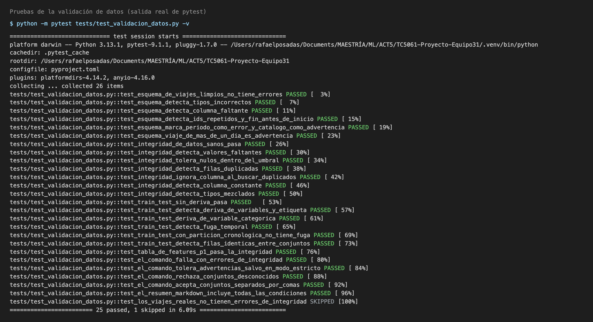

Ejecución del comando sobre los cuatro conjuntos:

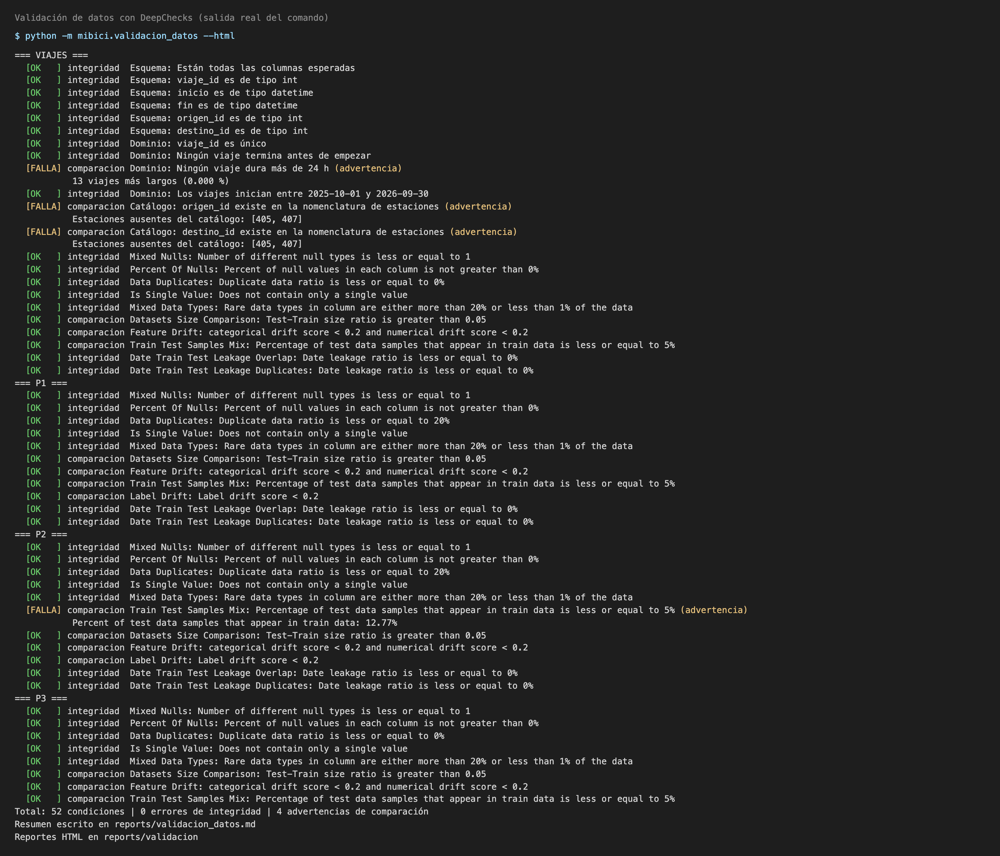

Reportes de DeepChecks (integridad de los viajes y comparación de entrenamiento contra prueba en P1):

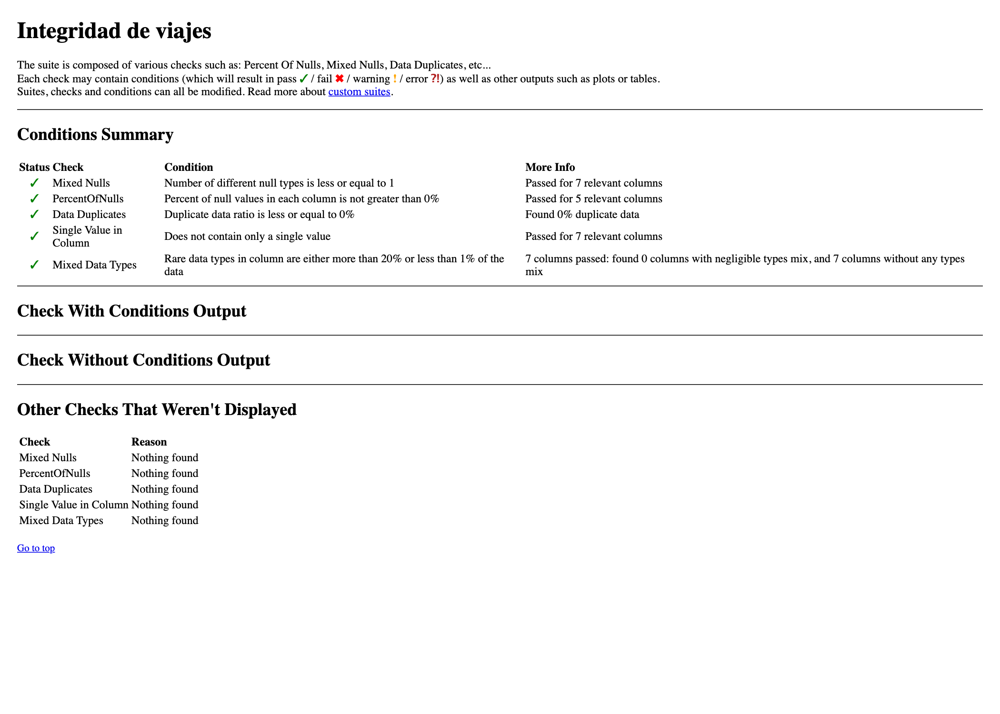

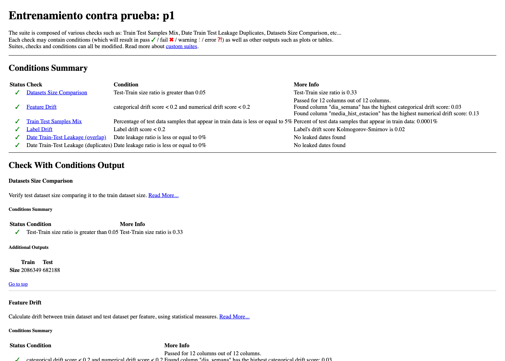

# Parte 3 — Pruebas automatizadas y seguridad

## 9. Pruebas automatizadas con PyTest

El proyecto incorpora pruebas automatizadas con **PyTest** para verificar el procesamiento de datos, la ingeniería de características, la reproducibilidad del entrenamiento y las validaciones de calidad de datos.

Las pruebas se encuentran en la carpeta `tests/` y pueden ejecutarse conjuntamente mediante un único comando.

### 9.1 Organización de las pruebas

| Archivo | Responsabilidad |
|---|---|
| `test_data.py` | Limpieza, duplicados, registros inválidos y casos límite |
| `test_features_p1.py` | Construcción de variables temporales y prevención de fuga de información |
| `test_features_p3.py` | Generación y consistencia de características para clustering |
| `test_reproducibilidad.py` | Consistencia de las predicciones de Random Forest utilizando la misma semilla |
| `test_validacion_datos.py` | Validaciones de esquema, integridad, duplicados, drift y separación temporal |
| `conftest.py` | Inicialización de compatibilidad para DeepChecks |

### 9.2 Ejecución

Desde la raíz del repositorio, con las dependencias instaladas:

```powershell
uv run --no-sync python -m pytest tests/ -v
```

Para obtener un resumen compacto:

```powershell
uv run --no-sync python -m pytest tests/ -q
```

### 9.3 Resultados

La ejecución completa del 1 de noviembre de 2026 obtuvo:

| Indicador | Resultado |
|---|---|
| Pruebas recopiladas | 37 |
| Pruebas exitosas | 36 |
| Pruebas fallidas | 0 |
| Pruebas omitidas | 1 |

La prueba omitida corresponde a la validación del dataset real, desactivada por defecto debido a su tiempo de ejecución. Puede habilitarse mediante la variable `MIBICI_VALIDAR_DATOS_REALES=1`.

La prueba de reproducibilidad verificó que dos entrenamientos de Random Forest con la misma semilla producen predicciones idénticas en el escenario evaluado.

Se observaron advertencias de obsolescencia procedentes de bibliotecas externas, sin impedir la ejecución de las pruebas.

## 10. Validación de calidad con DeepChecks

La validación de datos se realiza mediante `mibici/validacion_datos.py`, utilizando DeepChecks y controles adicionales de integridad.

Para ejecutar todos los conjuntos y generar los reportes HTML:

```powershell
uv run --no-sync python -m mibici.validacion_datos --conjuntos todos --html
```

### 10.1 Resultados

La ejecución sobre los conjuntos de viajes, P1, P2 y P3 produjo:

| Indicador | Resultado |
|---|---|
| Condiciones evaluadas | 52 |
| Errores de integridad | 0 |
| Advertencias de comparación | 4 |

Las advertencias corresponden a 13 viajes con duración superior a 24 horas, estaciones 405 y 407 ausentes del catálogo de origen y destino, y un 12.77 % de coincidencia de muestras de prueba con entrenamiento en P2, superior al umbral del 5 %.

La coincidencia de P2 requiere seguimiento, aunque las comprobaciones específicas de fuga temporal no detectaron errores.

El resumen se genera en `reports/validacion_datos.md` y los reportes HTML en `reports/validacion/`. Estos últimos se excluyen de Git por su tamaño y porque pueden regenerarse.

## 11. Análisis de seguridad

Se realizaron análisis estáticos del código, auditoría de dependencias y revisión básica del repositorio para identificar riesgos de seguridad.

### 11.1 Análisis estático con Bandit

Se utilizó Bandit para revisar recursivamente los archivos Python del paquete `mibici/`.

Instalación:

```powershell
uv pip install bandit
```

Ejecución:

```powershell
uv run --no-sync bandit -r mibici/
```

Para generar un reporte en texto:

```powershell
uv run --no-sync bandit -r mibici/ -f txt -o bandit_report.txt
```

**Resultados del análisis:**

| Severidad | Hallazgos |
|---|---|
| Alta | 0 |
| Media | 0 |
| Baja | 22 |

Se analizaron 3,607 líneas de código. Los hallazgos de severidad baja corresponden principalmente al uso de `subprocess`, llamadas al ejecutable `git` y detecciones incorrectas de posibles contraseñas en cadenas utilizadas para representar estados de validación.

Los hallazgos fueron revisados y no justificaron modificar los algoritmos de entrenamiento. No obstante, deben considerarse advertencias de análisis estático, no una garantía de ausencia de vulnerabilidades.

### 11.2 Auditoría de dependencias con pip-audit

Se utilizó `pip-audit` para identificar vulnerabilidades conocidas en los paquetes instalados.

Instalación:

```powershell
uv pip install pip-audit
```

Ejecución:

```powershell
uv run --no-sync pip-audit
```

El análisis inicial detectó **6 vulnerabilidades conocidas en 3 dependencias**.

| Dependencia | Versión inicial | Versión actualizada |
|---|---|---|
| `mlflow` | 3.17.1 | 3.17.2 |
| `requests` | 2.32.5 | 2.33.0 |
| `setuptools` | 80.9.0 | 84.1.0 |

Después de actualizar `requirements.txt` y reinstalar las dependencias, se repitió el análisis.

**Resultado final: 0 vulnerabilidades conocidas en las dependencias auditables.**

El paquete local `mibici` no pudo analizarse mediante la base de datos de PyPI, por lo que este resultado no representa una auditoría exhaustiva del código propio.

### 11.3 Revisión de credenciales y archivos sensibles

Se verificó la configuración de `.gitignore` para evitar incorporar archivos sensibles y artefactos locales al repositorio.

Entre las exclusiones existentes se encuentran:

- Archivos `.env` y variantes de configuración local.
- Entornos virtuales `.venv/`.
- Datos originales y procesados en `data/`.
- Bases de datos y artefactos de MLflow.
- Modelos serializados.
- Reportes HTML regenerables de DeepChecks.

Se ejecutaron búsquedas de patrones asociados con credenciales y de nombres de archivos sensibles entre los archivos rastreados por Git, sin obtener coincidencias.

También se ejecutó `git diff --check`, sin detectar problemas de formato.

Estas verificaciones constituyen una revisión básica y no sustituyen un análisis especializado del historial completo de Git.

## 12. Compatibilidad y verificación posterior a las actualizaciones

La actualización de `setuptools` eliminó la disponibilidad de `pkg_resources`, utilizado internamente por DeepChecks 0.19.1.

Para mantener las dependencias actualizadas se implementó una capa temporal de compatibilidad mediante:

- `mibici/compatibilidad.py`: proporciona las funcionalidades necesarias en memoria.
- `mibici/validacion_datos.py`: inicializa la compatibilidad antes de importar DeepChecks.
- `tests/conftest.py`: inicializa la compatibilidad durante las pruebas automatizadas.

La solución no modifica los archivos instalados de DeepChecks ni los algoritmos P1, P2 y P3.

Después de implementar el ajuste se verificó que:

1. El módulo de validación puede ejecutarse directamente.
2. La suite de PyTest continúa funcionando.
3. Los cuatro conjuntos de datos pueden validarse mediante DeepChecks.
4. La auditoría final de dependencias no identifica vulnerabilidades conocidas entre los paquetes auditables.

Esta adaptación es una solución temporal que deberá revisarse cuando cambien las dependencias.

## 13. Evidencias y trazabilidad

Los resultados de las pruebas, la validación de datos y las revisiones de seguridad se documentan mediante reportes y capturas conservados en el repositorio.

La ejecución de PyTest, los reportes de DeepChecks, los hallazgos de Bandit y el resultado final de pip-audit deberán contar con evidencia visual en `reports/figures/`.

Los cambios de seguridad, compatibilidad y documentación se desarrollan en una rama independiente y se integran mediante Pull Request, preservando el historial de contribuciones individuales del equipo.

### 13.1 Evidencias de ejecución

**Pruebas automatizadas con PyTest**

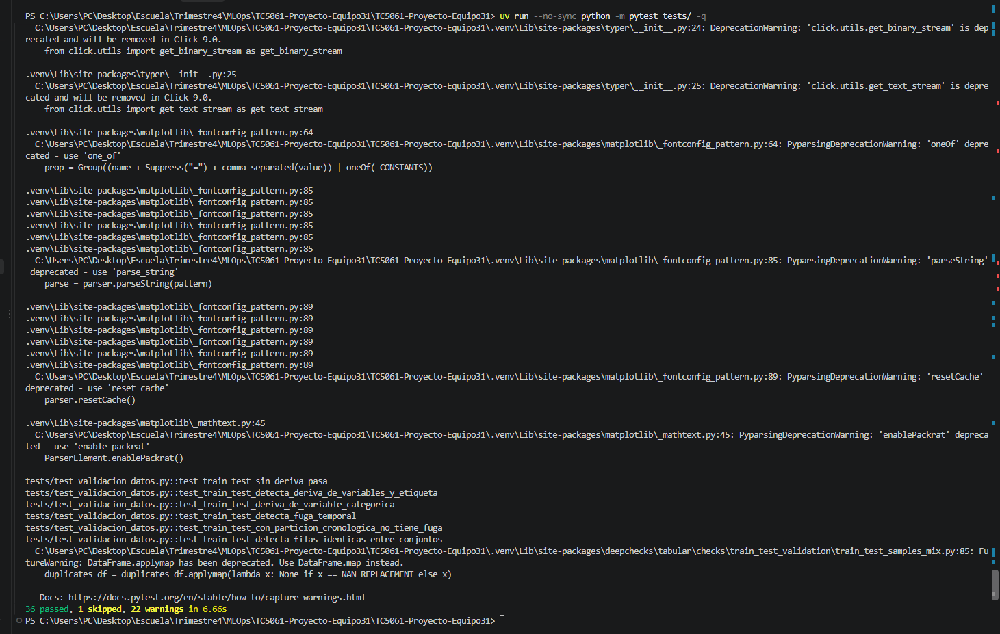

**Validación de datos con DeepChecks**

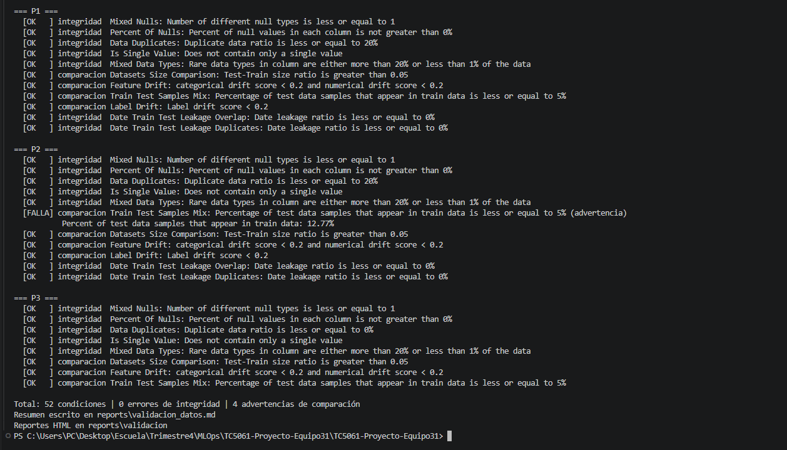

**Análisis estático con Bandit**

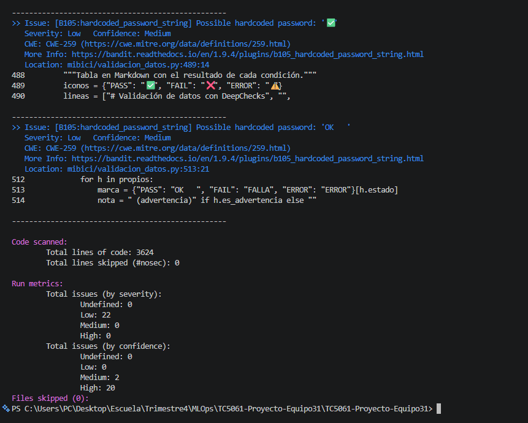

**Auditoría de dependencias con pip-audit**

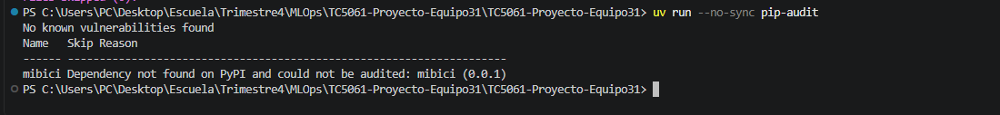


### Security checks and documentation

**Cambios realizados**
- Análisis estático de seguridad con Bandit.
- Auditoría de dependencias con pip-audit.
- Actualización de dependencias con vulnerabilidades conocidas.
- Implementación de compatibilidad para DeepChecks 0.19.1.
- Actualización del README con instrucciones y resultados.
- Incorporación de evidencias de ejecución.

**Verificaciones**
- PyTest: 36 pruebas exitosas, 1 omitida.
- DeepChecks: 52 condiciones, 0 errores de integridad y 4 advertencias.
- Bandit: 22 hallazgos de severidad baja, ninguno medio o alto.
- pip-audit: 0 vulnerabilidades conocidas en las dependencias auditables.

**Observaciones**

La compatibilidad de DeepChecks es temporal y se encuentra documentada. No se modificaron los algoritmos de entrenamiento.


# Parte 4 — Despliegue de modelos mediante FastAPI

## 14. Descripción del servicio

Se desarrolló una API REST utilizando FastAPI para ofrecer inferencia en tiempo real sobre los tres modelos del proyecto MiBici.

Los modelos se recuperan desde MLflow Model Registry mediante su nombre y versión, permitiendo separar el entrenamiento de la inferencia.

El servicio integra tres funcionalidades:

- **P1 — Regresión:** predicción de demanda de viajes por estación y hora.
- **P2 — Clasificación:** identificación de riesgo indirecto de desbalance en estaciones.
- **P3 — Clustering:** segmentación de estaciones según sus patrones de utilización.

La API permite realizar predicciones mediante peticiones HTTP y obtener las respuestas en formato JSON.

## 15. Modelos registrados en MLflow

Se ejecutaron nuevamente los experimentos de P1, P2 y P3, utilizando los candidatos desarrollados durante la etapa de optimización.

Los modelos seleccionados fueron registrados en MLflow Model Registry.

| Modelo | Nombre en Registry | Versión | Algoritmo |
|---|---|---|---|
| P1 | `mibici-p1` | 1 | HistGradientBoostingRegressor |
| P2 | `mibici-p2` | 1 | HistGradientBoostingClassifier |
| P3 | `mibici-p3` | 1 | K-Means (k=4) |

### 15.1 Resultados de los modelos

Los modelos registrados obtuvieron las siguientes métricas:

| Modelo | Métrica | Validación | Prueba |
|---|---|---:|---:|
| P1 | MAE | 0.7623 | 0.7654 |
| P2 | F1-score | 0.4235 | 0.4548 |
| P3 | Silhouette Score | 0.2049 | — |

El modelo P1 se seleccionó por su menor MAE de validación entre los candidatos evaluados. P2 se seleccionó por su mayor F1-score de validación entre los resultados comparados. P3 se seleccionó por su mejor Silhouette Score.

Estas métricas corresponden a los experimentos realizados y no representan pruebas de desempeño de la API.

### 15.2 Reproducir los experimentos

Con el servidor MLflow activo y los datos procesados disponibles:

```powershell
$env:MLFLOW_TRACKING_URI = "http://127.0.0.1:5000"

mlflow run . -e experiments -P question=p1 --env-manager local --experiment-name mibici-equipo31
mlflow run . -e experiments -P question=p2 --env-manager local --experiment-name mibici-equipo31
mlflow run . -e experiments -P question=p3 --env-manager local --experiment-name mibici-equipo31
```

Se utiliza `--env-manager local` para aprovechar el entorno virtual existente. Durante las pruebas en Windows se encontró un problema al intentar crear un entorno aislado con `uv`, relacionado con la instalación editable del proyecto y la referencia a `README.md`.

Las corridas deben ejecutarse desde la raíz del proyecto y requieren haber preparado previamente los datos.

### 15.3 Recuperación de modelos

La carga de modelos está implementada en `mibici/model_loader.py`.

Este módulo configura la conexión a MLflow mediante la variable de entorno `MLFLOW_TRACKING_URI` y recupera los modelos utilizando las siguientes referencias:

```python
MODELS = {
    "p1": "models:/mibici-p1/1",
    "p2": "models:/mibici-p2/1",
    "p3": "models:/mibici-p3/1",
}
```

La función `load_model(question)` permite cargar cualquiera de los tres modelos. Si no se especifica una pregunta, se recupera P3 por defecto.

Ejemplo:

```python
from mibici.model_loader import load_model

model_p1 = load_model("p1")
model_p2 = load_model("p2")
model_p3 = load_model("p3")
```

La recuperación de los tres modelos fue comprobada exitosamente desde Python.

**Importante:** la base de datos y los artefactos del Registry están almacenados localmente y no se incluyen en GitHub. Para reproducir el servicio en otra máquina es necesario disponer de un servidor MLflow con los modelos registrados y sus artefactos accesibles.

## 16. Implementación de la API REST

La aplicación se encuentra en `mibici/api.py` y utiliza FastAPI, Pydantic, pandas y los modelos de scikit-learn recuperados desde MLflow.

### 16.1 Estructura implementada

```text
mibici/
├── model_loader.py    # Recuperación desde MLflow Registry
└── api.py             # Servicio REST con FastAPI
```

Las dependencias FastAPI y Uvicorn se agregaron al proyecto mediante `uv add`.

### 16.2 Endpoints disponibles

| Método | Endpoint | Funcionalidad |
|---|---|---|
| GET | `/health` | Verificación del servicio |
| POST | `/predict/p1` | Predicción de demanda |
| POST | `/predict/p2` | Clasificación de riesgo |
| POST | `/predict/p3` | Segmentación de estaciones |
| POST | `/predict` | Compatibilidad con P3 |

Los endpoints de predicción utilizan esquemas Pydantic para definir los campos y tipos de entrada.

### 16.3 Variables utilizadas

**P1 — Regresión (17 variables)**

`hora`, `dia_semana`, `fin_semana`, `lag_1`, `lag_2`, `lag_3`, `lag_24`, `lag_168`, `media_movil_24`, `media_movil_168`, `media_hist_estacion_dow_hora`, `media_hist_estacion`, `media_hist_estacion_hora`, `tendencia_24_168`, `hora_sin`, `hora_cos`, `prop_horas_cero_24`.

**P2 — Clasificación (13 variables)**

`hora`, `dia_semana`, `fin_semana`, `capacidad`, `salidas_lag_1`, `llegadas_lag_1`, `flujo_neto_lag_1`, `presion_lag_1`, `presion_lag_2`, `presion_lag_24`, `presion_lag_168`, `presion_media_24`, `presion_media_168`.

**P3 — Clustering (6 variables)**

`viajes_diarios`, `balance_relativo`, `proporcion_fin_semana`, `manana`, `mediodia`, `tarde`.

Las variables deben calcularse utilizando los criterios de ingeniería de características definidos durante el entrenamiento.

## 17. Ejecución local de la API

### 17.1 Instalar dependencias

Desde la raíz del proyecto:

```powershell
uv sync
```

### 17.2 Iniciar MLflow

En una primera terminal PowerShell:

```powershell
uv run mlflow server --backend-store-uri sqlite:///mlflow.db --host 127.0.0.1 --port 5000
```

La interfaz de MLflow estará disponible en:

http://127.0.0.1:5000

### 17.3 Iniciar FastAPI

En una segunda terminal PowerShell:

```powershell
$env:MLFLOW_TRACKING_URI = "http://127.0.0.1:5000"

uv run uvicorn mibici.api:app --reload --port 8000
```

La API recupera los tres modelos registrados al iniciar la aplicación. Por ello, MLflow debe encontrarse disponible y contener las versiones configuradas.

### 17.4 Documentación interactiva

La documentación Swagger UI se genera automáticamente en:

http://127.0.0.1:8000/docs

Desde esta interfaz es posible consultar los esquemas, enviar peticiones y revisar las respuestas.

## 18. Ejemplos de peticiones

### 18.1 P1 — Predicción de demanda

**Endpoint:** `POST /predict/p1`

Petición:

```json
{
  "hora": 8,
  "dia_semana": 2,
  "fin_semana": 0,
  "lag_1": 5,
  "lag_2": 4,
  "lag_3": 6,
  "lag_24": 7,
  "lag_168": 5,
  "media_movil_24": 5.5,
  "media_movil_168": 5.2,
  "media_hist_estacion_dow_hora": 6,
  "media_hist_estacion": 4.8,
  "media_hist_estacion_hora": 6.2,
  "tendencia_24_168": 0.3,
  "hora_sin": 0.8660254,
  "hora_cos": -0.5,
  "prop_horas_cero_24": 0.1
}
```

La respuesta contiene el campo `demanda_predicha`, con el valor numérico calculado por el regresor.

### 18.2 P2 — Clasificación de riesgo

**Endpoint:** `POST /predict/p2`

Petición:

```json
{
  "hora": 8,
  "dia_semana": 2,
  "fin_semana": 0,
  "capacidad": 20,
  "salidas_lag_1": 8,
  "llegadas_lag_1": 5,
  "flujo_neto_lag_1": -3,
  "presion_lag_1": 0.15,
  "presion_lag_2": 0.1,
  "presion_lag_24": 0.2,
  "presion_lag_168": 0.12,
  "presion_media_24": 0.15,
  "presion_media_168": 0.13
}
```

La respuesta contiene `clase_predicha`, con una clasificación binaria (`0` o `1`).

### 18.3 P3 — Segmentación de estaciones

**Endpoint:** `POST /predict/p3`

Petición:

```json
{
  "viajes_diarios": 100,
  "balance_relativo": 0.2,
  "proporcion_fin_semana": 0.3,
  "manana": 0.4,
  "mediodia": 0.35,
  "tarde": 0.25
}
```

Respuesta obtenida durante la prueba:

```json
{
  "cluster": 2
}
```

El modelo asigna las características proporcionadas a uno de cuatro clusters (0, 1, 2 o 3).

Los ejemplos de esta sección son entradas ilustrativas utilizadas para comprobar el funcionamiento técnico de los endpoints, no observaciones verificadas de estaciones reales.

## 19. Pruebas de funcionamiento

Se realizaron pruebas locales mediante Swagger UI sobre los tres endpoints de predicción.

| Endpoint | Resultado HTTP | Estado |
|---|---|---|
| `GET /health` | 200 OK | Exitoso |
| `POST /predict/p1` | 200 OK | Exitoso |
| `POST /predict/p2` | 200 OK | Exitoso |
| `POST /predict/p3` | 200 OK | Exitoso |

Las pruebas confirmaron que la API recibe las entradas, ejecuta los modelos recuperados desde MLflow y devuelve respuestas JSON.

Estas pruebas validan la integración funcional local, pero no sustituyen las pruebas automatizadas ni la evaluación predictiva con datos reales.

## 20. Estrategia de despliegue

Se eligió una estrategia de **inferencia en tiempo real mediante API REST**, porque permite consultar los modelos utilizando peticiones HTTP.

Los tres modelos se integraron inicialmente en una sola aplicación FastAPI, facilitando el consumo del servicio y reutilizando la conexión con MLflow.

La estrategia seleccionada utiliza:

- **MLflow Model Registry:** almacenamiento y versionado de modelos.
- **FastAPI:** exposición de endpoints REST.
- **Pydantic:** definición inicial de esquemas de entrada.
- **scikit-learn:** ejecución de inferencias.
- **MLFLOW_TRACKING_URI:** configuración de la conexión con MLflow.

El diseño utiliza una única API con múltiples endpoints; no constituye todavía una arquitectura de microservicios.

### Consideraciones técnicas

P1 y P2 requieren características históricas calculadas previamente. La API no genera automáticamente estas variables a partir de los registros originales de viajes.

P2 utiliza actualmente `predict()` del modelo registrado, por lo que aplica el comportamiento de clasificación del estimador. Si se decide utilizar el umbral optimizado durante la experimentación, será necesario incorporarlo explícitamente al servicio.

Los modelos se cargan al iniciar FastAPI. Por ello, el servidor MLflow debe estar disponible durante el arranque, aunque las inferencias posteriores se realizan utilizando los modelos cargados en memoria.

## 21. Contenedor: construcción, ejecución y consumo de la API

La API de la sección 16 se empaqueta en una imagen OCI definida en [`Containerfile`](Containerfile). El motor de contenedores elegido es **Docker** (se probó con Docker Desktop 29.5 en macOS).

### 21.1 Cómo se obtiene el modelo dentro del contenedor

Se combinan las dos opciones que permite la actividad:

| Modelo | Origen dentro del contenedor | Configuración |
|---|---|---|
| **P1** (demanda) | **Empaquetado en la imagen**: copia del modelo descargado del Registry en [`modelos_serving/`](modelos_serving/) (formato MLflow con firma y ejemplo de entrada) | Variable `MIBICI_MODEL_P1_PATH=/app/modelos_serving`, ya definida en el `Containerfile` |
| **P2** (riesgo) y **P3** (grupos) | **Model Registry de MLflow**, por nombre y versión (`models:/mibici-equipo31-p2-riesgo/1` y `models:/mibici-equipo31-p3-grupos/1`) | Variable `MLFLOW_TRACKING_URI` apuntando al servidor |

> **¿Qué es el Model Registry?** Es el catálogo de modelos de MLflow: guarda cada modelo entrenado con un **nombre** y un número de **versión** (por ejemplo, `mibici-equipo31-p3-grupos`, versión 1), junto con el experimento, la corrida y los datos de los que salió. El servicio pide el modelo por nombre y versión (`models:/<nombre>/<versión>`) en lugar de buscar un archivo, de modo que se puede cambiar de versión sin tocar el código de la API. Vive en el servidor de MLflow, por eso el contenedor necesita su dirección (`MLFLOW_TRACKING_URI`).

Con esto la imagen funciona sola para P1 (no necesita red ni servidor MLflow) y, si se le indica dónde está el Registry, también sirve P2 y P3. La lógica está en [`mibici/model_loader.py`](mibici/model_loader.py): si existe `MIBICI_MODEL_<P1|P2|P3>_PATH` carga la carpeta local; si no, consulta el Registry.

### 21.2 Construir la imagen

Desde la raíz del repositorio:

```bash
docker build -f Containerfile -t mibici-api:1.0 .
```

El archivo `.dockerignore` (y `.containerignore`) deja fuera de la imagen los datos, las pruebas, los reportes, los notebooks y cualquier archivo `.env`, llave o certificado. La imagen resultante pesa unos 1.3 GB (principalmente MLflow y scikit-learn).

### 21.3 Levantar el contenedor

**Solo P1** (sin Registry):

```bash
docker run -d --name mibici-api -p 8000:8000 mibici-api:1.0
```

**P1, P2 y P3** (con un servidor MLflow en la máquina anfitriona):

```bash
# Desde el contenedor, la máquina anfitriona se ve como host.docker.internal
docker run -d --name mibici-api -p 8000:8000 \
  -e MLFLOW_TRACKING_URI=http://host.docker.internal:5000 mibici-api:1.0
```

El servidor MLflow rechaza por defecto los encabezados `Host` desconocidos (protección contra DNS rebinding), así que debe autorizar el nombre que usa el contenedor, sin abrirlo a la red:

```bash
mlflow server --backend-store-uri sqlite:///mlflow.db --host 127.0.0.1 --port 5000 \
  --allowed-hosts "localhost:5000,127.0.0.1:5000,host.docker.internal:5000"
```

Comprobar que el contenedor está activo y revisar sus registros:

```bash
docker ps --filter name=mibici-api
docker logs mibici-api
```

### 21.4 Consumir la API

Los ejemplos de entrada están en [`references/ejemplos_api/`](references/ejemplos_api/). Documentación interactiva: <http://127.0.0.1:8000/docs>.

**Estado del servicio**

```bash
curl -s http://127.0.0.1:8000/health
```

```json
{"status":"ok"}
```

**Predicción de demanda (P1)**

```bash
curl -s -X POST http://127.0.0.1:8000/predict/p1 \
  -H "Content-Type: application/json" \
  -d @references/ejemplos_api/p1.json
```

Respuesta obtenida desde el contenedor (HTTP 200):

```json
{"demanda_predicha":6.513090266629504}
```

**Segmentación de estaciones (P3, modelo del Registry)**

```bash
curl -s -X POST http://127.0.0.1:8000/predict/p3 \
  -H "Content-Type: application/json" \
  -d @references/ejemplos_api/p3.json
```

Respuesta obtenida desde el contenedor con `MLFLOW_TRACKING_URI` apuntando a un servidor local (HTTP 200):

```json
{"cluster":2}
```

**Validación de entradas.** Con `hora = 25` ([`p1_hora_invalida.json`](references/ejemplos_api/p1_hora_invalida.json)) la API rechaza la petición antes de llamar al modelo (HTTP 422):

```json
{"detail":[{"type":"less_than_equal","loc":["body","hora"],"msg":"Input should be less than or equal to 23","input":25,"ctx":{"le":23}}]}
```

Los esquemas de [`mibici/esquemas_api.py`](mibici/esquemas_api.py) también rechazan campos faltantes (`missing`) o adicionales (`extra_forbidden`), valores `NaN` o infinitos y tipos que no coinciden.

### 21.5 Prueba automatizada del contenedor

El script [`scripts/probar_contenedor.sh`](scripts/probar_contenedor.sh) construye la imagen, levanta el contenedor, espera a que responda, verifica los códigos HTTP y el contenido de cada respuesta, y elimina el contenedor al terminar:

```bash
scripts/probar_contenedor.sh                         # prueba /health, P1 y un caso inválido
MLFLOW_TRACKING_URI=http://host.docker.internal:5000 scripts/probar_contenedor.sh   # además P2 y P3
```

Resultado de la última ejecución (con la imagen ya construida):

```text
[OK]    GET  /health -> HTTP 200  {"status":"ok"}
[OK]    POST /predict/p1 (modelo empaquetado en la imagen) -> HTTP 200  {"demanda_predicha":6.513090266629504}
[OK]    POST /predict/p1 con hora = 25 (debe rechazarse) -> HTTP 422  {"detail":[{"type":"less_than_equal", ...
[OMITIDO] P2 y P3: definir MLFLOW_TRACKING_URI para probarlos desde el Registry
== Todas las pruebas pasaron
```

### 21.6 Evidencia de ejecución

Construcción de la imagen, contenedor en ejecución y peticiones con `curl` (salida real de los comandos):

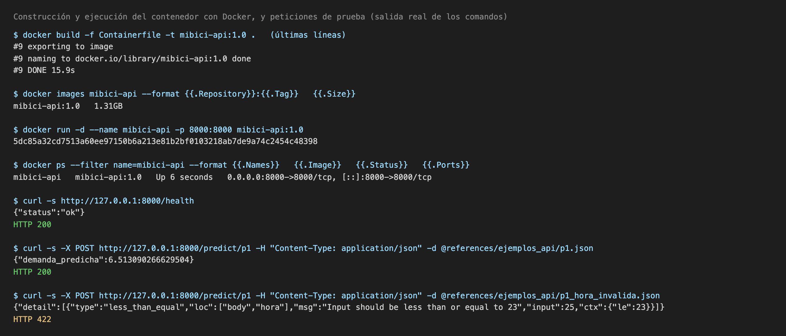

Swagger UI servido por el contenedor, con una petición `POST /predict/p1` que devuelve HTTP 200:

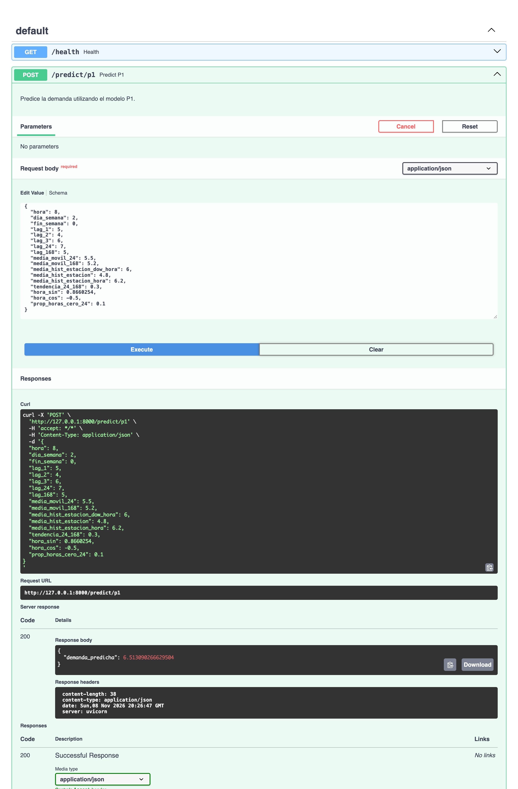

Contenedor con `MLFLOW_TRACKING_URI` apuntando a un servidor MLflow local (en esta prueba, en el puerto 5001): P3 se carga del Registry y P1 del modelo empaquetado (ambos HTTP 200):

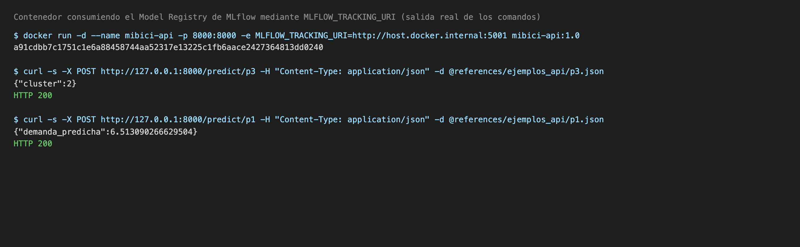

### 21.7 Estrategia de despliegue

Se eligió **inferencia en tiempo real mediante una API REST empaquetada en un contenedor**, por estas razones:

- **La decisión es por estación y por hora.** El operador y el equipo de rebalanceo necesitan consultar la demanda o el riesgo de una estación concreta en la siguiente hora; una petición HTTP por consulta encaja con ese uso. Los modelos son pequeños (el de P1 pesa unos 3 MB) y, medido desde el anfitrión con `curl`, `/predict/p1` respondió en 29 ms la primera vez y en 7 ms la segunda.
- **Servicio sin estado.** Cada petición lleva todas sus variables, así que se pueden levantar varias réplicas del mismo contenedor sin coordinarlas.
- **Reproducibilidad.** La imagen fija las versiones de Python y de las librerías y, para P1, incluye el modelo; funciona igual en cualquier máquina con Docker.
- **Separación entre entrenamiento e inferencia.** P2 y P3 se leen del Model Registry por nombre y versión, de modo que cambiar de versión no obliga a reconstruir la imagen.

La inferencia **por lotes** (calcular cada hora la predicción de las 470 estaciones y guardarla) también es posible con la misma imagen, y sería preferible para P3, cuyos perfiles cambian lentamente. No se eligió como estrategia principal porque requiere programar y almacenar los resultados, algo que queda fuera de esta entrega.

### 21.8 Limitaciones y observaciones del despliegue

- **La API no calcula las variables de entrada.** P1 y P2 usan rezagos y promedios históricos de la estación; quien consume el servicio debe enviarlos ya calculados con los criterios de entrenamiento. Un servicio de variables o un trabajo por lotes sería el siguiente paso.
- **P2 aplica el umbral de 0.5.** `predict()` del modelo registrado no incorpora el umbral de 0.714 que se eligió en validación (sección 15.1).
- **Versión de scikit-learn.** El `Containerfile` fija `scikit-learn==1.9.1`, la versión con la que se entrenaron los modelos registrados, mientras que `requirements.txt` fija `1.7.2`. Un modelo entrenado con el entorno de `requirements.txt` no se puede cargar en la imagen: una prueba con un modelo P2 entrenado con 1.7.2 falló con `ModuleNotFoundError: No module named '_loss'`. Conviene unificar la versión en ambos archivos y en `python_env.yaml`.
- **Dirección del anfitrión.** El `Containerfile` define por defecto `MLFLOW_TRACKING_URI=http://host.containers.internal:5000`, un nombre que Docker no resuelve: la primera petición a P2 o P3 queda esperando mientras MLflow reintenta. Con Docker hay que pasar `-e MLFLOW_TRACKING_URI=http://host.docker.internal:5000` (sección 21.3).
- **Nombres en el Registry.** El código (`model_loader.py`) usa `mibici-equipo31-p1-demanda`, `mibici-equipo31-p2-riesgo` y `mibici-equipo31-p3-grupos`, versión 1; la tabla de la sección 15 y los ejemplos de la 15.3 muestran `mibici-p1`, `mibici-p2` y `mibici-p3`. Deben coincidir con los nombres realmente registrados en el servidor que use el contenedor.
- **Qué se verificó desde el contenedor.** `/health`, `/predict/p1` (modelo empaquetado) y `/predict/p3` (modelo del Registry) devolvieron HTTP 200, y las entradas inválidas devolvieron 422. `/predict/p2` desde el Registry no se pudo verificar en la máquina de pruebas porque el modelo P2 disponible allí se había entrenado con scikit-learn 1.7.2 (punto anterior); su ruta de carga es la misma que la de P3.
