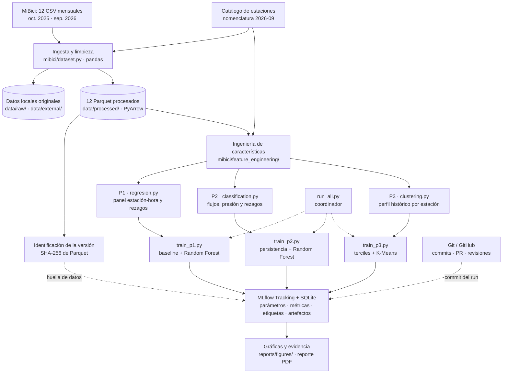

# Arquitectura del sistema — MiBici (Equipo 31)

**Periodo de análisis:** octubre de 2025 a septiembre de 2026 (12 meses).  
**Estilo:** procesamiento local por lotes (*batch*), ingesta compartida, pipelines modulares y seguimiento experimental con MLflow.  
**Alcance:** entrenamiento y evaluación reproducibles; no incluye una API ni un servicio de predicción en tiempo real.

## 1. Objetivo y alcance

El proyecto procesa los datos abiertos del sistema MiBici mediante una **ingesta común** y tres pipelines independientes: P1 predice demanda por estación-hora; P2 clasifica un indicador indirecto de riesgo de desbalance por estación-hora; y P3 agrupa estaciones con patrones históricos semejantes. La separación entre adquisición, características, entrenamiento y registro experimental permite repetir cada análisis y rastrear sus entradas, código y resultados.

| Pregunta | Unidad y horizonte | Baseline implementado | Modelo candidato | Aplicación |
|---|---|---|---|---|
| **P1 — Regresión** | Estación-hora; horizonte de una hora | Promedio histórico | `RandomForestRegressor` | Anticipar demanda y apoyar redistribución. |
| **P2 — Clasificación** | Estación-hora; horizonte de una hora | Persistencia de la presión de desbalance de la hora previa | `RandomForestClassifier` optimizado | Priorizar revisión de estaciones con riesgo *proxy*. |
| **P3 — Clustering** | Estación; sin horizonte predictivo | Terciles de demanda | `KMeans` (k = 3) | Analizar perfiles de estaciones para planeación. |

La etiqueta de P2 representa **presión de flujos**, no disponibilidad real de bicicletas o anclajes; los CSV no contienen inventarios históricos.

## 2. Diagrama de arquitectura



Las flechas continuas representan el flujo de información; las discontinuas, coordinación y trazabilidad. Los tres scripts de entrenamiento están presentes en el código revisado y habilitados en `run_all.py`. La generación y validación del **manifiesto versionado de hashes por archivo** corresponde al mecanismo de integridad que desarrolla el equipo; no debe confundirse con la huella conjunta registrada por los scripts en MLflow.

## 3. Componentes y herramientas

| Componente | Tecnología o archivo | Función y justificación |
|---|---|---|
| Fuentes | [MiBici — datos abiertos](https://www.mibici.net/es/datos-abiertos/) y catálogo de septiembre de 2026 | Aportan los registros y metadatos de estaciones utilizados para el análisis. |
| Ingesta | Python, `pandas`, `mibici/dataset.py` | Descarga los archivos, normaliza columnas, tipos y codificación, depura duplicados y genera insumos comunes. |
| Almacenamiento | `data/raw/`, `data/external/`, `data/processed/`; Parquet/PyArrow | Separa insumos originales de los procesados y aprovecha lectura columnar para millones de registros. |
| Características | `mibici/feature_engineering/regresion.py`, `classification.py`, `clustering.py`; `mibici/features.py` | Mantiene transformaciones especializadas fuera de los notebooks, en funciones reutilizables. P1/P3 también están reexportadas por `features.py`; P2 importa directamente `classification.py` en la versión revisada. |
| Modelado y evaluación | `scikit-learn`, `matplotlib` | Compara baselines con Random Forest o K-Means y produce métricas y figuras adecuadas para cada pregunta. |
| Orquestación | `mibici/run_all.py` | Verifica los 12 Parquet y ejecuta secuencialmente P1, P2 y P3 mediante módulos Python, deteniéndose si falla alguno. |
| Seguimiento | MLflow Tracking, `mlflow.db` (SQLite local) | Registra ejecuciones del experimento `mibici-equipo31`, métricas, configuración, artefactos y etiquetas. |
| Versionado y colaboración | Git, GitHub y Pull Requests | Permite identificar versiones del código y revisar los cambios antes de incorporarlos a `main`. |
| Presentación | `reports/figures/`, `references/` y PDF | Separa material de comunicación y diseño del procesamiento y entrenamiento. |

## 4. Pipelines implementados

### 4.1 P1 — Regresión de demanda

A partir de los archivos Parquet se construye un panel por estación-hora, incluyendo periodos de cero salidas. `regresion.py` incorpora calendario, rezagos de demanda de **1, 2, 3, 24 y 168 horas**, estadísticas históricas y medias móviles de **24 y 168 horas**. `train_p1.py` compara la referencia de demanda histórica con `RandomForestRegressor` y registra métricas como **MAE, RMSE y MAE en horas pico**. Los cortes cronológicos implementados son entrenamiento (octubre 2025–mayo 2026), validación (junio–julio 2026) y prueba (agosto–septiembre 2026). Las variables predictivas se calculan con información anterior a la hora objetivo.

### 4.2 P2 — Clasificación de riesgo *proxy*

`classification.py` agrega **salidas por hora de inicio** y **llegadas por hora de terminación**, une la capacidad de la nomenclatura de estaciones y crea un panel estación-hora con intervalos sin movimientos. Las estaciones sin capacidad conocida se excluyen de este pipeline. La presión de desbalance observada se define como:

\[
\text{presión de desbalance} = \frac{|\text{llegadas} - \text{salidas}|}{\text{capacidad}}
\]

La **etiqueta binaria de riesgo alto** se activa cuando la presión observada alcanza o supera el **percentil 90 calculado exclusivamente con entrenamiento**. Esta definición es una aproximación basada en flujos; no confirma que una estación esté vacía o llena. La capacidad proviene del catálogo de septiembre de 2026, por lo que su validez histórica para los meses anteriores es una limitación.

Se utilizan **13 características**: hora, día de semana, fin de semana, capacidad, rezagos de salidas/llegadas/flujo neto (1 h), rezagos de presión (1, 2, 24 y 168 h) y promedios históricos de presión (24 y 168 h). Se descartan las primeras 168 horas de calentamiento por estación. Los cortes de entrenamiento, validación y prueba son los mismos periodos cronológicos de P1.

`train_p2.py` compara el **baseline de persistencia** —riesgo inferido a partir de la presión de la hora previa— con un `RandomForestClassifier` optimizado. El candidato usa `n_estimators=150`, `max_depth=30`, `min_samples_leaf=10`, `max_samples=0.3`, `max_features=0.8` y semilla 42; cuando hay más registros, entrena con una muestra reproducible de hasta **250 000 filas**. Registra **precision, recall, F1 y PR-AUC** en validación y prueba, junto con una matriz de confusión como artefacto. El umbral de clasificación del Random Forest es **0.5**.

Los rezagos y promedios móviles usan `shift(1)` para impedir que la observación objetivo entre en los predictores. La implementación etiqueta la presión de la fila horaria evaluada a partir de las variables rezagadas; esta convención debe describirse consistentemente como predicción del próximo intervalo disponible.

### 4.3 P3 — Segmentación de estaciones

`clustering.py` construye perfiles de estaciones usando los doce meses: demanda media diaria, balance relativo, proporción de salidas en fin de semana y distribución horaria en cuatro franjas. Se excluyen estaciones con menos de **100 salidas**; se transforma la demanda mediante `log1p`, se elimina la franja nocturna por redundancia y se estandarizan **seis características** mediante `StandardScaler`.

`train_p3.py` compara terciles de demanda y `KMeans` con **tres grupos**, `random_state=42` y `n_init=10`. Los resultados registrados para **470 estaciones** son:

| Método | Silhouette Score (`train_silhouette_score`) |
|---|---:|
| Terciles de demanda | 0.0732 |
| K-Means (`k=3`) | **0.1992** |

La proyección PCA de dos componentes explica aproximadamente **56.3 %** de la varianza y se registra como artefacto gráfico. La segmentación representa patrones descriptivos del periodo completo; aún no demuestra estabilidad temporal ni implica una predicción de ocupación.

## 5. Ejecución y seguimiento experimental

Todos los comandos se ejecutan desde la raíz del repositorio, con las dependencias de `requirements.txt` instaladas:

```powershell
# Generación de los datos procesados (cuando no existan)
python -m mibici.dataset

# Ejecuciones individuales
python -m mibici.train_p1
python -m mibici.train_p2
python -m mibici.train_p3

# Ejecución conjunta: P1, P2 y P3
python -m mibici.run_all

# Interfaz del experimento local
mlflow ui --backend-store-uri "sqlite:///mlflow.db"
```

El equipo confirmó la ejecución satisfactoria de `run_all.py`. Cada módulo registra sus experimentos en **`mibici-equipo31`** utilizando el archivo SQLite local ubicado en la raíz del proyecto. Los runs almacenan parámetros, métricas etiquetadas por conjunto cuando corresponde (`val_` / `test_`), identificadores de equipo y pregunta, hash del commit (`git_commit`) y artefactos gráficos. El historial de MLflow es local y no se incorpora al repositorio.

Los scripts registran una huella SHA-256 conjunta de los Parquet empleados. Para verificar y reproducir exactamente las descargas y salidas entre equipos, se requiere además un **manifiesto por archivo** con hashes y conteos, versionado en Git. El responsable de la ingesta está trabajando en ese componente; su incorporación debe verificarse antes de considerar completo el criterio de integridad.

## 6. Justificación de las decisiones arquitectónicas

1. **Una ingesta compartida y tres entrenamientos separados.** Elimina duplicación en limpieza de datos y permite cambiar características o modelos sin alterar el pipeline de las demás preguntas.
2. **Procesamiento batch y datos columnares.** Los insumos se publican por mes y el objetivo es experimental, por lo que una plataforma distribuida o un servicio en tiempo real introduciría complejidad innecesaria. Parquet mejora el uso de almacenamiento y las lecturas selectivas.
3. **Ingeniería de características reutilizable.** Las funciones viven en el módulo `mibici`, mientras que los notebooks se reservan para exploración, facilitando repetición y pruebas.
4. **Separación temporal y prevención de fuga.** P1 y P2 utilizan particiones cronológicas y variables históricas; P3 aprende perfiles descriptivos sobre un periodo claramente delimitado.
5. **Trazabilidad de código, datos y experimentos.** Git identifica cambios de código; SHA-256 identifica el contenido de datos; MLflow conserva condiciones y resultados del entrenamiento. Estos mecanismos son complementarios, no equivalentes.
6. **Revisión mediante Pull Requests.** Las ramas y reglas de protección de `main` promueven colaboración auditable y permiten asociar los commits del repositorio a los runs.

Estas decisiones se relacionan con la separación de responsabilidades, modularidad y mantenibilidad de *Software Architecture* y *Software Design* del **SWEBOK Guide V4.0a** (Washizaki, 2025), y con las prácticas de experimentación trazable de MLflow. La elección de métricas sigue la guía de evaluación de scikit-learn.

## 7. Alcance de validación y limitaciones

La **ingesta y los tres entrenamientos** están desarrollados en módulos independientes y el equipo reportó que `run_all.py` ejecuta satisfactoriamente la secuencia completa. La interfaz y las capturas finales de MLflow constituyen la evidencia de sus corridas. La evaluación de la arquitectura reconoce cuatro límites: (a) la disponibilidad de bicicletas no puede inferirse directamente de los CSV; (b) la capacidad de septiembre de 2026 puede no representar todos los meses; (c) P3 no ha sido validado aún por estabilidad temporal; y (d) el manifiesto versionado con verificación de integridad debe confirmarse cuando se integre el aporte de ingesta.

## 8. Referencias

- MiBici. (s. f.). *Datos abiertos*. https://www.mibici.net/es/datos-abiertos/
- MLflow. (s. f.). *MLflow Tracking*. https://mlflow.org/docs/latest/ml/tracking/
- scikit-learn developers. (s. f.). *Model evaluation: Quantifying the quality of predictions*. https://scikit-learn.org/stable/modules/model_evaluation.html
- Washizaki, H. (Ed.). (2025). *Guide to the Software Engineering Body of Knowledge (SWEBOK Guide V4.0a)*. IEEE Computer Society. https://www.computer.org/education/bodies-of-knowledge/software-engineering

**Documentos relacionados:** `references/definicion_datos.md`, `references/limpieza_datos.md`, `references/modelos_metricas.md` y `references/pipelines_ml.md`.
