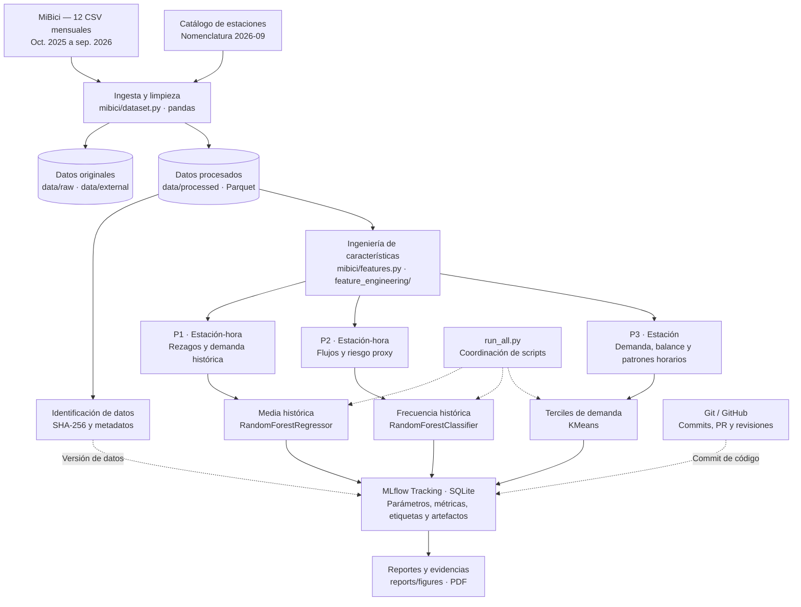

# Arquitectura del sistema — MiBici (Equipo 31)

**Periodo de análisis:** octubre de 2025 a septiembre de 2026.  
**Enfoque arquitectónico:** procesamiento local por lotes, pipelines independientes y seguimiento de experimentos.  
**Estado del diseño:** arquitectura definida para P1 (regresión), P2 (clasificación) y P3 (clustering).

## 1. Objetivo y alcance

El sistema organiza el análisis de los datos abiertos de MiBici en tres pipelines que comparten la misma ingesta y almacenamiento, pero construyen características y evalúan modelos según sus objetivos. La solución prioriza reproducibilidad, modularidad y trazabilidad, sin requerir una API o un despliegue en tiempo real.

| Pregunta | Unidad y horizonte | Baseline | Modelo candidato | Uso operativo |
|---|---|---|---|---|
| **P1 — Regresión de demanda** | Estación-hora; siguiente hora | Promedio histórico de demanda | `RandomForestRegressor` | Anticipar demanda para apoyar redistribución. |
| **P2 — Clasificación de riesgo** | Estación-hora; siguiente hora | Frecuencia histórica de riesgo | `RandomForestClassifier` | Identificar posibles desequilibrios y priorizar revisiones. |
| **P3 — Clustering de estaciones** | Estación; sin horizonte predictivo | Terciles de demanda | `KMeans` | Caracterizar tipos de estaciones para planeación. |

En P2, el riesgo se entiende como un **indicador indirecto (*proxy*) de desbalance basado en flujos**, no como inventario real de bicicletas o espacios libres: esa información no está presente en los CSV de viajes.

## 2. Diagrama de arquitectura



Las flechas continuas representan el recorrido de los datos; las discontinuas representan coordinación y trazabilidad. El diagrama expresa **la arquitectura definida para las tres preguntas**, sin depender de que sus ejecuciones se hayan realizado en una misma computadora.

## 3. Componentes y herramientas

| Componente | Herramientas | Responsabilidad y justificación |
|---|---|---|
| **Fuentes** | [MiBici, datos abiertos](https://www.mibici.net/es/datos-abiertos/), CSV mensuales y catálogo de estaciones | Proveer registros de viajes y atributos disponibles de estaciones. |
| **Ingesta** | Python, `pandas`, `mibici/dataset.py` | Descargar los archivos, normalizar columnas/codificaciones/fechas, eliminar duplicados y conservar un proceso común entre modelos. |
| **Almacenamiento** | `data/raw/`, `data/external/`, `data/processed/`, Parquet y PyArrow | Separar insumos originales de datos depurados; aprovechar un formato columnar eficiente para millones de viajes. |
| **Trazabilidad de datos** | `hashlib` / SHA-256 y registro de metadatos | Identificar los archivos de entrada de cada experimento; los hashes no sustituyen un manifiesto versionado por archivo. |
| **Características** | `mibici/features.py` y `mibici/feature_engineering/` | Producir variables específicas por tarea en funciones reutilizables. |
| **Modelos** | `scikit-learn` | Comparar baselines sencillos con Random Forest en P1/P2 y K-Means en P3. |
| **Evaluación** | `scikit-learn`, `matplotlib`, PCA para visualización | Medir error, clasificación o separación según la pregunta y generar figuras interpretables. |
| **Registro** | MLflow Tracking con SQLite local | Conservar parámetros, métricas, etiquetas de equipo/pregunta/commit y artefactos. |
| **Colaboración** | Git, GitHub, ramas y Pull Requests | Revisar contribuciones y vincular versiones de código con los experimentos. |
| **Entrega** | `references/`, `reports/figures/`, README y PDF | Centralizar arquitectura, metodología, resultados y evidencias. |

## 4. Pipelines de aprendizaje automático

### 4.1 P1 — Predicción de demanda

El procesamiento genera un panel **estación-hora**, incluyendo intervalos sin salidas, y utiliza variables de calendario y estadísticas de demanda histórica. El código de regresión comprende rezagos de **1, 2, 3, 24 y 168 horas**, medias móviles de **24 y 168 horas** y promedios históricos por estación y calendario. Se comparan un baseline de media histórica y `RandomForestRegressor` mediante **MAE, RMSE y MAE en horas pico**.

La partición temporal implementada corresponde a **octubre 2025–mayo 2026** (entrenamiento), **junio–julio 2026** (validación) y **agosto–septiembre 2026** (prueba). Las estadísticas predictivas se calculan utilizando únicamente el pasado disponible con respecto a la hora objetivo.

### 4.2 P2 — Clasificación de riesgo de desbalance

La arquitectura de P2 construye una tabla **estación-hora** con conteos históricos de salidas y llegadas, balances y variables temporales; la capacidad de estación puede incorporarse cuando su vigencia histórica sea verificable. La etiqueta objetivo representa un **riesgo proxy de desbalance para la hora siguiente**. Los flujos de esa hora futura se reservan para construir la etiqueta y **no se introducen como características de predicción**.

Se definieron un baseline de **frecuencia histórica de riesgo** y un candidato **`RandomForestClassifier`**. Las métricas son **recall, precision y F1-score**, acompañadas de la distribución de clases y, cuando corresponda, matriz de confusión. El umbral del indicador debe documentarse junto con el código que genera las etiquetas para asegurar una evaluación verificable.

### 4.3 P3 — Segmentación de estaciones

El pipeline agrega los doce meses disponibles en una fila por estación. Construye demanda media diaria, balance relativo, proporción de salidas en fines de semana y distribución horaria por franjas. Excluye estaciones con **menos de 100 salidas** durante el periodo, aplica `log1p` a la intensidad de demanda, elimina una franja horaria redundante y estandariza **seis características** con `StandardScaler`.

Se compararon un baseline por **terciles de demanda** y `KMeans` con **tres grupos**, `random_state=42` y `n_init=10`, sobre la misma matriz escalada. La evaluación registrada para las 470 estaciones fue:

| Método | Silhouette Score |
|---|---:|
| Baseline — terciles de demanda | 0.0732 |
| K-Means (`k=3`) | **0.1992** |

La visualización PCA en dos dimensiones representa aproximadamente **56.3 % de la varianza**. Los resultados describen perfiles exploratorios; no demuestran disponibilidad real ni garantizan estabilidad temporal.

## 5. Ejecución, seguimiento y reproducibilidad

La organización permite correr cada pipeline de forma independiente desde módulos del repositorio:

```powershell
# Preparación de los datos
python -m mibici.dataset

# Entrenamientos disponibles en el código revisado
python -m mibici.train_p1
python -m mibici.train_p3

# Coordinador del proyecto (ejecuta los módulos habilitados)
python -m mibici.run_all

# Visualizar los runs de la base de datos local
mlflow ui --backend-store-uri "sqlite:///mlflow.db"
```

La arquitectura de P2 sigue la misma convención de ejecución al integrarse su módulo correspondiente. `run_all.py` centraliza la coordinación; los experimentos comparten el nombre **`mibici-equipo31`** y deben apuntar al mismo almacenamiento de MLflow para que la interfaz muestre todas las corridas.

Para cada run se registran, según la tarea, el periodo y la versión de datos, parámetros del modelo y semilla, métricas identificadas por conjunto, etiquetas `equipo`, `pregunta`, `git_commit` y al menos un artefacto. Los archivos de datos, las bases de MLflow, los modelos serializados y las credenciales se excluyen de Git mediante `.gitignore`; `requirements.txt` contiene las versiones directas fijadas.

**Verificación de integridad:** P3 calcula una huella SHA-256 de los Parquet que utiliza. Para cubrir completamente el criterio de versionado de datos, el repositorio debe incorporar también un manifiesto con los archivos, sus conteos y hashes, confirmado mediante una ejecución reproducible. Este punto no se da por verificado solamente porque exista una huella registrada en MLflow.

## 6. Decisiones de arquitectura y fundamentos

1. **Ingesta compartida, modelos independientes.** Reduce limpieza duplicada y desacuerdos entre conjuntos; cada pregunta conserva su propio preprocesamiento y evaluación.
2. **Procesamiento por lotes, sin servicios de producción.** Es proporcional a los archivos mensuales y al propósito académico; evita complejidad de infraestructura sin beneficio inmediato.
3. **Separación entre notebooks y módulos.** Los notebooks documentan exploración, mientras que el entrenamiento reproducible se ejecuta desde scripts con responsabilidades claras.
4. **Prevención de fuga temporal.** P1 y P2 requieren cortes cronológicos y características calculadas con información disponible antes de la predicción; P3 utiliza perfiles históricos y reconoce la necesidad de validar estabilidad posterior.
5. **Git para código, hashes para datos y MLflow para experimentos.** Son responsabilidades complementarias: un commit no identifica los datos locales y una base MLflow no sustituye el código fuente.

Estas decisiones se fundamentan en los principios de modularidad, separación de responsabilidades, mantenibilidad y trazabilidad de *Software Architecture* y *Software Design* del **SWEBOK Guide V4.0a** (Washizaki, 2025), y en las prácticas de seguimiento y evaluación documentadas por MLflow y scikit-learn.

## 7. Estado de integración y criterios de verificación

La **arquitectura de las tres preguntas está definida**. La revisión del código compartido respalda los pipelines de **P1 y P3**; para **P2**, este documento fija el diseño de integración establecido en el ML Canvas, sin atribuirle resultados experimentales que no han sido aportados.

La comprobación completa del sistema requiere la disponibilidad de los scripts de las tres preguntas, el manifiesto de datos por archivo, una ejecución del coordinador con P1/P2/P3 habilitados y la evidencia consolidada de sus runs en MLflow. Estas comprobaciones pertenecen al cierre de integración del equipo y no modifican las decisiones arquitectónicas descritas.

## 8. Referencias

- MiBici. (s. f.). *Datos abiertos*. https://www.mibici.net/es/datos-abiertos/
- MLflow. (s. f.). *MLflow Tracking*. https://mlflow.org/docs/latest/ml/tracking/
- scikit-learn developers. (s. f.). *Model evaluation: Quantifying the quality of predictions*. https://scikit-learn.org/stable/modules/model_evaluation.html
- Washizaki, H. (Ed.). (2025). *Guide to the Software Engineering Body of Knowledge (SWEBOK Guide V4.0a)*. IEEE Computer Society. https://www.computer.org/education/bodies-of-knowledge/software-engineering

**Documentos relacionados:** `references/definicion_datos.md`, `references/pipelines_ml.md`, `references/modelos_metricas.md` y `references/limpieza_datos.md`.
