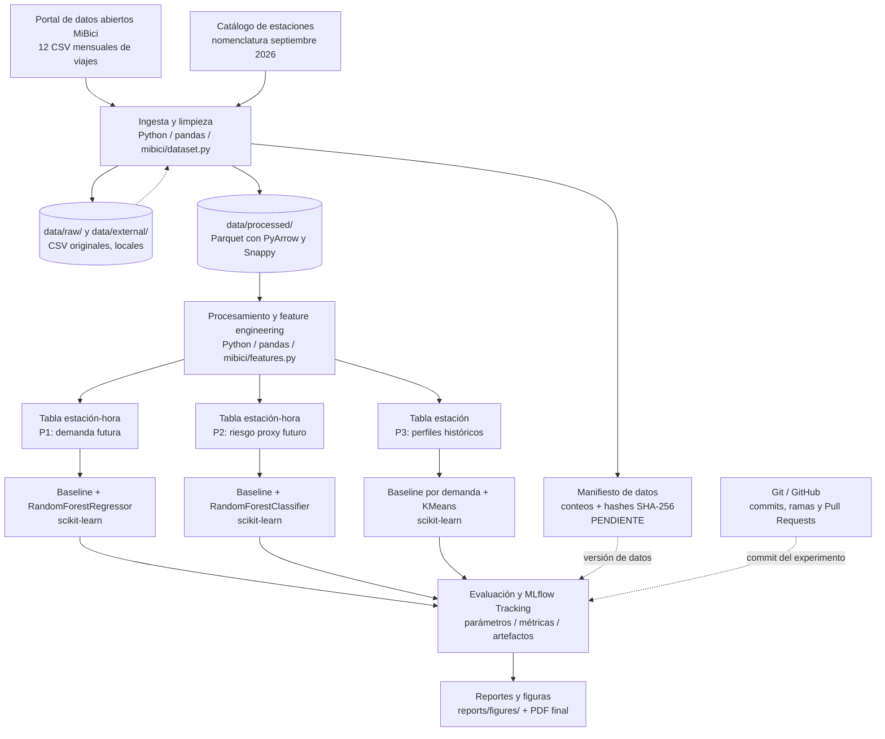

# Propuesta de arquitectura del sistema — MiBici (Equipo 31)

**Estado:** Arquitectura propuesta para la primera entrega; implementación parcial.  
**Periodo:** Octubre de 2025 a septiembre de 2026.  
**Alcance:** Experimentos reproducibles y procesamiento *batch* local; **no** se propone desplegar una aplicación o servicio en tiempo real.

## 1. Objetivo y enfoque

Proponer una arquitectura modular que permita descargar, limpiar y versionar los datos históricos de MiBici **una sola vez**, reutilizarlos en las preguntas P1 (regresión), P2 (clasificación) y P3 (clustering), y registrar experimentos comparables en MLflow. El repositorio y el flujo de integración de GitHub proporcionan trazabilidad del código; el manifiesto de datos proporcionará trazabilidad de los archivos.

## 2. Diagrama de arquitectura

El siguiente diagrama está escrito en **Mermaid** para poder editarlo y visualizarlo directamente desde Markdown compatible, como GitHub.

**Leyenda:** las flechas continuas representan el flujo de datos; las discontinuas, información de trazabilidad o reutilización. El manifiesto SHA-256 es **obligatorio para la actividad, pero aún está pendiente de implementación**. Las tablas de features, los modelos y sus corridas MLflow también representan componentes propuestos, no resultados ya obtenidos.

## 3. Componentes y herramientas

| Componente | Herramienta o ubicación | Función | Justificación |
|---|---|---|---|
| Fuentes | [Portal de datos abiertos MiBici](https://mibici.net/es/datos-abiertos/) y [catálogo de estaciones (septiembre 2026)](https://mibici.net/site/assets/files/1118/nomenclatura_2026_09.csv) | Obtener viajes y metadatos de las estaciones. | Fuentes primarias vinculadas a las preguntas del proyecto. |
| Ingesta y limpieza | Python, `pandas`, `mibici/dataset.py` | Descargar 12 meses, unificar codificaciones/columnas/fechas, validar y eliminar duplicados. | Centraliza la lógica común y evita preprocesamientos inconsistentes entre integrantes. |
| Datos crudos | `data/raw/`, `data/external/` (local) | Conservar descargas originales para reconstrucción y auditoría. | Separar originales de derivados evita modificaciones irreversibles del insumo. |
| Datos procesados | `data/processed/`, Parquet, PyArrow, Snappy | Almacenar los datos depurados por mes. | Formato columnar comprimido apropiado para leer y agregar millones de filas. |
| Versionado de datos | Manifiesto con nombres, filas y hashes SHA-256 versionado en Git (**pendiente**) | Identificar de forma verificable las entradas y salidas de cada corrida. | Un commit de código por sí solo no identifica el contenido de archivos excluidos del repositorio. |
| Feature engineering | `mibici/features.py`, `pandas` | Producir tablas de estación-hora para P1/P2 y perfiles por estación para P3. | Reutilización, funciones documentadas y prevención de fugas de información. |
| Modelado | `scikit-learn` en scripts del módulo `mibici/` | Implementar los tres baselines y candidatos: Random Forest (P1/P2) y K-Means (P3). | Biblioteca estable para comparar modelos clásicos con poca complejidad operativa. |
| Evaluación | `scikit-learn` y visualizaciones | Calcular MAE/RMSE, recall/precision/F1 y Silhouette, según el problema. | Métricas relacionadas con el objetivo y comparables frente a baselines. |
| Seguimiento de experimentos | MLflow Tracking local | Registrar parámetros, métricas, artefactos, versión de datos, pregunta y commit. | Permite comparar ejecuciones y reconstruir condiciones del experimento. |
| Colaboración | Git / GitHub, ramas y Pull Requests | Versionar código/documentación y revisar aportaciones. | Historial de cambios y evidencia de trabajo colaborativo. |
| Resultados | `reports/figures/`, `references/` y PDF final | Compartir gráficos, diseño y evidencias. | Separa productos de análisis del código y de los datos sensibles. |

## 4. Flujo de ejecución propuesto

1. Ejecutar `python -m mibici.dataset main` desde la raíz del repositorio para descargar y limpiar los datos. El comando debe verificarse en un clon limpio.
2. Guardar los CSV locales y los doce Parquet mensuales en carpetas separadas, sin incluirlos en Git. Generar un manifiesto de integridad y versionado; **esta parte todavía está pendiente**.
3. Crear las características desde funciones de `mibici/features.py`:
   - **P1:** conteos de salidas por estación-hora, hora/día, rezagos y promedios calculados con pasado disponible.
   - **P2:** llegadas, salidas, balances históricos y capacidad válida; etiqueta futura **proxy** de riesgo, cuya fórmula y umbral deben acordarse.
   - **P3:** una fila por estación con demanda media diaria, perfil horario, proporción de fin de semana y balance relativo; unir coordenadas para mapas e interpretación.
4. Ejecutar scripts independientes de entrenamiento y evaluación para cada pregunta. Los nombres definitivos de los scripts se acordarán durante la implementación. Comparar cada modelo candidato con su baseline.
5. Registrar las corridas en un experimento MLflow con número de equipo, parámetros (periodo, semilla y versión de datos), métricas identificadas por conjunto, etiquetas (P1/P2/P3 y commit Git) y artefactos. Usar código del repositorio, no únicamente notebooks.
6. Exportar figuras y capturas de MLflow para el documento final. Mantener `data/`, `mlruns/`, `mlartifacts/`, modelos serializados y credenciales fuera de Git.

## 5. Diseño de evaluación y control de fugas

- **P1 y P2:** partición cronológica **propuesta**: entrenamiento de octubre 2025 a mayo 2026, validación en junio y julio 2026, y prueba en agosto y septiembre 2026. Calcular rezagos solo con información anterior a la hora objetivo. Ajustar transformaciones aprendidas exclusivamente sobre entrenamiento.
- **P2:** el riesgo corresponde a un **indicador indirecto** basado en flujos y capacidad, no a la ocupación real de anclajes. Los datos futuros sirven únicamente para las etiquetas, nunca como predictor.
- **P3:** construir grupos con perfiles históricos y analizar su estabilidad en meses posteriores. El clustering no necesita horizonte predictivo ni etiquetas verdaderas.
- Registrar semillas, configuración y versión de entrada en `mibici/config.py` y en MLflow; las versiones de dependencias se fijarán en `requirements.txt`.

## 6. Decisiones de arquitectura y relación con buenas prácticas de MLOps

1. **Pipeline común + modelos separados:** compartir ingesta y transformaciones de propósito general, pero separar entrenamientos/evaluaciones por pregunta. Reduce duplicación y facilita que tres integrantes trabajen en ramas distintas.
2. **Procesamiento por lotes y ejecución local:** los CSV se publican mensualmente; la entrega exige un baseline reproducible, no inferencia en tiempo real. Evita introducir innecesariamente servidores, bases de datos o contenedores.
3. **Datos fuera de Git, identificados por hashes:** evita subir archivos voluminosos o datos sensibles, pero mantiene la posibilidad de verificar qué datos usó cada experimento.
4. **Código de entrenamiento separado de notebooks:** notebooks para exploración; lógica reproducible en módulos y scripts ejecutables desde terminal.
5. **Trazabilidad doble:** Git identifica el código y MLflow enlaza código, parámetros, métricas y artefactos. El manifiesto pendiente permitirá enlazar también la versión exacta de datos.

Estas elecciones se alinean con principios generales de reproducibilidad, modularidad y seguimiento experimental en MLOps. **Para cumplir literalmente la petición de justificar según las lecturas de la semana, el equipo deberá añadir citas específicas de esas lecturas**; aún no están identificadas en los materiales disponibles aquí.

## 7. Estado de implementación y pendientes

**Ya reportado/observado en el repositorio compartido:** plantilla Cookiecutter Data Science, configuración base, código de descarga/limpieza en `mibici/dataset.py` y salidas Parquet; el equipo informó 4,497,119 viajes procesados en 12 meses. Estos resultados no han sido ejecutados de nuevo desde esta documentación.

**Pendiente:** completar el manifiesto SHA-256 y su verificación; fijar dependencias; implementar `features.py`, baselines y candidatos en scripts ejecutables; acordar etiqueta/umbral P2; ejecutar y registrar corridas en MLflow; comprobar clon limpio y añadir referencias a las lecturas del curso.

## 8. Fuentes y documentos internos

- MiBici. (s. f.). *Datos abiertos*. https://mibici.net/es/datos-abiertos/
- MLflow. (s. f.). *MLflow Tracking*. https://mlflow.org/docs/latest/ml/tracking/
- scikit-learn developers. (s. f.). *Model evaluation: Quantifying the quality of predictions*. https://scikit-learn.org/stable/modules/model_evaluation.html
- Documentación del equipo: `references/definicion_datos.md`, `references/pipelines_ml.md`, `references/modelos_metricas.md` y `references/limpieza_datos.md`.

> **Nota:** El diagrama representa una arquitectura propuesta; se actualizará para reflejar la implementación final y las decisiones tomadas entre los integrantes.
