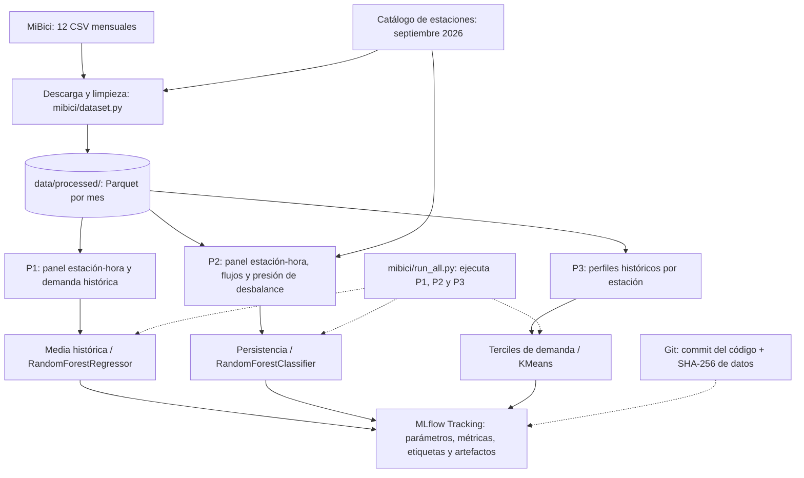

# Pipelines de Machine Learning — MiBici (Equipo 31)

**Periodo de análisis:** octubre de 2025 a septiembre de 2026 (12 meses).  
**Enfoque:** procesamiento local por lotes, transformaciones reutilizables y trazabilidad con MLflow.  
**Cobertura:** P1 (regresión), P2 (clasificación de riesgo indirecto) y P3 (clustering).

## 1. Objetivo y pipeline común

El proyecto comparte una sola etapa de descarga y limpieza de datos, seguida de tres pipelines de entrenamiento y evaluación independientes. Los modelos utilizan los doce archivos Parquet mensuales generados por `mibici/dataset.py`. Cada pregunta cuenta con agregaciones, variables, método de referencia y modelo candidato específicos, ejecutados desde scripts del repositorio en lugar de depender de los notebooks.



### 1.1 Ingesta y limpieza compartidas

`mibici/dataset.py` descarga los doce CSV de viajes y la nomenclatura, normaliza nombres de columnas y fechas, contempla UTF-8 y CP1252, elimina registros duplicados o inválidos y conserva cinco columnas operativas: `viaje_id`, `inicio`, `fin`, `origen_id` y `destino_id`. Los datos se almacenan por mes en Parquet con PyArrow y compresión Snappy.

El equipo reportó **4,497,877 viajes originales**, **758 duplicados eliminados** y **4,497,119 registros procesados**. Los doce Parquet se mantienen en `data/processed/`, fuera de Git. La nomenclatura de estaciones se conserva en `data/external/`.

Para ejecutar la ingesta, desde la raíz del repositorio:

```powershell
python -m mibici.dataset
```

Los scripts de entrenamiento registran en MLflow una huella SHA-256 de los Parquet utilizados. **El manifiesto por archivo, con hashes y conteos versionados en Git, se está integrando por separado**; registrar un hash combinado en MLflow no sustituye esa verificación de integridad.

## 2. P1 — Predicción de demanda por estación-hora

**Pregunta:** ¿cuántos viajes comenzarán en una estación durante la próxima hora?  
**Granularidad:** estación-hora. **Horizonte:** una hora.  
**Módulos:** `mibici/feature_engineering/regresion.py`, `mibici/features.py` y `mibici/train_p1.py`.

| Etapa | Implementación |
|---|---|
| Agregación | Cuenta viajes iniciados por estación y hora, incluyendo intervalos sin viajes desde la primera actividad observada de la estación. |
| Objetivo | Demanda de la hora objetivo, expresada como número de viajes iniciados. |
| Características | Hora, día de la semana, fin de semana; rezagos de **1, 2, 3, 24 y 168 horas**; promedios móviles de **24 y 168 horas**; medias históricas por estación y por estación/día/hora. |
| Prevención de fuga | Las variables históricas se construyen utilizando únicamente observaciones anteriores a la hora objetivo; se descartan las primeras 168 horas de cada estación. |
| Baseline | Media histórica de la estación para el mismo día de semana y hora, con alternativas históricas cuando falta suficiente información. |
| Modelo candidato | `RandomForestRegressor` con `n_estimators=100`, `min_samples_leaf=20`, `max_samples=0.3` y `random_state=42`. |
| Evaluación | **MAE**, **RMSE** y **MAE en horas pico**, calculados en validación y prueba. |

### 2.1 Partición cronológica

| Conjunto | Periodo |
|---|---|
| Entrenamiento | Octubre 2025 – mayo 2026 |
| Validación | Junio – julio 2026 |
| Prueba | Agosto – septiembre 2026 |

`dividir_temporal_p1()` establece los cortes cronológicos. Los rezagos pueden recurrir al pasado anterior a la frontera de un conjunto sin utilizar datos posteriores al momento de predicción. El código registra en MLflow los runs de media histórica y Random Forest, así como artefactos de desempeño. **Los valores numéricos de MAE/RMSE deberán tomarse de los runs verificados; no se infieren del script.**

## 3. P2 — Clasificación de riesgo indirecto de desbalance

**Pregunta:** ¿una estación registrará un nivel alto de presión de desbalance durante la siguiente hora?  
**Granularidad:** estación-hora. **Horizonte:** una hora.  
**Módulos:** `mibici/feature_engineering/classification.py` y `mibici/train_p2.py`.

| Etapa | Implementación |
|---|---|
| Agregación | Calcula salidas por hora de `inicio` y llegadas por hora de `fin`, por estación. Completa horas sin movimientos desde la primera actividad de cada estación. |
| Catálogo | Incorpora la capacidad `dpcapacity` desde la nomenclatura de septiembre de 2026; excluye estaciones sin capacidad positiva conocida. |
| Presión observada | `presion_desbalance = abs(llegadas - salidas) / capacidad`. |
| Etiqueta | Riesgo alto si la presión observada de la hora objetivo es **mayor o igual al percentil 90** de presión calculado exclusivamente con entrenamiento. |
| Características | **13 variables:** hora, día de semana, fin de semana, capacidad; rezagos de 1 hora de salidas, llegadas y flujo neto; presión en rezagos 1, 2, 24 y 168 horas; promedios históricos de presión de 24 y 168 horas. |
| Prevención de fuga | Todos los rezagos y promedios se construyen con datos pasados; se excluyen las primeras **168 horas** por estación. El umbral de la etiqueta se calcula solo sobre entrenamiento. |
| Baseline | **Persistencia de presión:** predice riesgo cuando `presion_lag_1` supera el umbral aprendido en entrenamiento. |
| Modelo candidato | `RandomForestClassifier` optimizado: **150 árboles**, profundidad máxima **30**, `min_samples_leaf=10`, `max_samples=0.3`, `max_features=0.8`, `class_weight="balanced_subsample"` y semilla **42**. |
| Evaluación | **Precision, recall, F1 y PR-AUC** en validación y prueba, además de matrices de confusión. |

### 3.1 Evaluación y control temporal

P2 utiliza la misma partición cronológica de P1: entrenamiento octubre de 2025–mayo de 2026, validación junio–julio y prueba agosto–septiembre. El entrenamiento de Random Forest se limita a **250,000 filas muestreadas** si el conjunto supera ese tamaño. El umbral de clasificación de probabilidades del Random Forest es **0.5**.

La función `crear_features_p2()` conserva separadas las variables pasadas de la presión observada en la hora objetivo, usada para construir la etiqueta. Las métricas miden la detección del **indicador proxy**, no la disponibilidad real de bicicletas: los CSV no contienen inventarios históricos. Además, la capacidad del catálogo de septiembre de 2026 se utiliza como referencia y podría no coincidir con capacidades anteriores.

El script `train_p2.py` registra `P2-baseline-persistencia` y `P2-random-forest-optimizado` en MLflow, con métricas para validación/prueba y un artefacto de matriz de confusión por run. El código consigna un proceso de selección de hiperparámetros de 72 combinaciones y cinco finalistas; su detalle experimental se documenta por separado.

## 4. P3 — Clustering de estaciones

**Pregunta:** ¿qué estaciones tienen patrones históricos de uso semejantes?  
**Granularidad:** una fila por estación. **Horizonte:** no aplica.  
**Módulos:** `mibici/feature_engineering/clustering.py`, `mibici/features.py` y `mibici/train_p3.py`.

| Etapa | Implementación |
|---|---|
| Agregación | Calcula salidas, llegadas, demanda promedio, balance relativo, fines de semana y distribución horaria de cada estación. |
| Filtrado | Excluye estaciones con menos de **100 salidas**: se utilizan **470 estaciones**. |
| Características iniciales | `viajes_diarios`, `balance_relativo`, `proporcion_fin_semana`, `manana`, `mediodia`, `tarde` y `noche`. |
| Transformación | Aplica `log1p` a `viajes_diarios`, elimina `noche` por redundancia y estandariza las **seis** características restantes con `StandardScaler`. |
| Baseline | Terciles de demanda diaria, con tres grupos. |
| Candidato | `KMeans(n_clusters=3, random_state=42, n_init=10)`. |
| Evaluación | Silhouette Score calculado sobre la **misma matriz escalada** para ambos métodos; tamaños de grupos y perfiles promedio. |
| Visualización | PCA de dos componentes aplicado únicamente para visualizar los clusters ya calculados. |

### 4.1 Resultados registrados

| Modelo | Estaciones | Silhouette Score |
|---|---:|---:|
| Baseline — terciles de demanda | 470 | 0.0732 |
| K-Means (k=3) | 470 | **0.1992** |

Los tres grupos de K-Means contienen **154, 198 y 118 estaciones**, respectivamente. El PCA de dos dimensiones explica aproximadamente **56.3 %** de la varianza de las características escaladas. El valor de Silhouette mejoró respecto al baseline, aunque persiste superposición entre grupos.

### 4.2 Alcance temporal y limitaciones

P3 utiliza todo el periodo histórico para describir perfiles de estaciones, no una partición de entrenamiento/prueba supervisada. **No se ha evaluado la estabilidad de los clusters en meses posteriores.** La demanda diaria utiliza los días presentes en el conjunto global, lo que puede subestimar la actividad de estaciones incorporadas durante el año. Ningún balance de flujos equivale directamente al inventario de bicicletas disponible.

## 5. Ejecución reproducible y registro en MLflow

Las transformaciones de P1 y P3 están disponibles en funciones reutilizables desde `mibici/features.py`; P2 mantiene su ingeniería de características en `mibici/feature_engineering/classification.py`. La ejecución definitiva se realiza desde scripts, no desde notebooks.

Desde la raíz del proyecto, una vez instaladas las dependencias y preparados los doce Parquet:

```powershell
python -m mibici.train_p1
python -m mibici.train_p2
python -m mibici.train_p3

# Ejecución conjunta de los tres pipelines:
python -m mibici.run_all

# Interfaz de experimentos:
mlflow ui --backend-store-uri "sqlite:///mlflow.db"
```

`run_all.py` ejecuta **los tres pipelines habilitados**, tal como se confirmó en la prueba conjunta del equipo. Los experimentos comparten `mibici-equipo31` y un backend SQLite local. Los runs registran parámetros de reproducción, intervalo temporal, versión de datos, métricas correspondientes a cada pregunta, etiquetas `equipo`, `pregunta` y `git_commit` y artefactos gráficos.

Las versiones directas de las dependencias se fijan en `requirements.txt`; `.gitignore` excluye datos locales, `mlflow.db`, `mlruns/`, `mlartifacts/`, archivos `.env` y modelos serializados. El manifiesto de integridad con hashes individuales y conteos debe verificarse tras su incorporación al repositorio.

## 6. Justificación y decisiones técnicas

- **Ingesta única, tres pipelines independientes:** reduce repetición de limpieza, facilita pruebas y permite comparar métodos específicos por pregunta.
- **Procesamiento por lotes y Parquet:** adecuado para CSV mensuales y millones de registros sin introducir servicios de producción innecesarios.
- **Variables históricas causales:** en P1/P2 los rezagos evitan utilizar movimientos ocurridos después de la hora objetivo; los umbrales de P2 se calculan exclusivamente con entrenamiento.
- **Separación de notebooks y scripts:** los notebooks documentan exploración, mientras que el módulo `mibici` contiene la lógica reutilizable y ejecutable.
- **Trazabilidad complementaria:** Git identifica el código; SHA-256 identifica el contenido de los datos utilizados; MLflow conserva parámetros, métricas y artefactos.

## 7. Referencias y documentación relacionada

- MiBici. (s. f.). *Datos abiertos*. https://www.mibici.net/es/datos-abiertos/
- MLflow. (s. f.). *MLflow Tracking*. https://mlflow.org/docs/latest/ml/tracking/
- scikit-learn developers. (s. f.). *Metrics and scoring: Quantifying the quality of predictions*. https://scikit-learn.org/stable/modules/model_evaluation.html
- scikit-learn developers. (s. f.). *Clustering*. https://scikit-learn.org/stable/modules/clustering.html

**Documentos relacionados:** `references/arquitectura_sistema.md`, `references/definicion_datos.md`, `references/limpieza_datos.md` y `references/modelos_metricas.md`.
