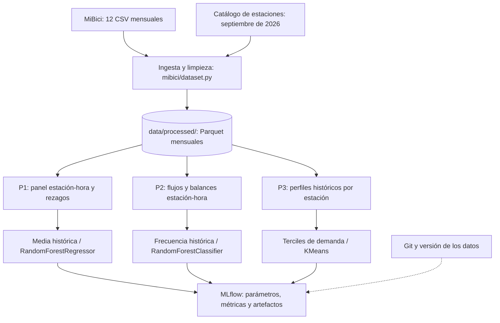

# Pipelines de Machine Learning — MiBici (Equipo 31)

**Periodo de análisis:** octubre de 2025 a septiembre de 2026 (12 meses).  
**Enfoque:** procesamiento por lotes, código reutilizable y experimentos trazables.  
**Cobertura:** P1 (regresión), P2 (clasificación de un indicador indirecto) y P3 (clustering).

## 1. Objetivo y pipeline común

Se establece una ingesta compartida para evitar diferencias de limpieza entre las tres preguntas, seguida de transformaciones y modelos específicos. P1 y P3 tienen implementaciones en el módulo del repositorio; el flujo de P2 se describe conforme a la definición adoptada en el ML Canvas y requiere contrastarse con el script final de clasificación.



### 1.1 Descarga, normalización y almacenamiento

`mibici/dataset.py` descarga los doce archivos de viajes y la nomenclatura de estaciones, normaliza nombres de columnas y tipos, gestiona las codificaciones UTF-8 y CP1252, elimina duplicados exactos y registros inválidos, y guarda los datos depurados en Parquet con PyArrow. Los campos operativos conservados son `viaje_id`, `inicio`, `fin`, `origen_id` y `destino_id`; no se conservan identificadores de usuario ni atributos demográficos en los Parquet procesados.

En la ingesta realizada por el equipo se reportaron **4,497,877 registros originales, 758 duplicados eliminados y 4,497,119 viajes procesados**, distribuidos en doce archivos Parquet. Se identificaron 471 estaciones en los viajes y 484 en la nomenclatura. Las estaciones 405 y 407 aparecen en los viajes pero no en el catálogo de septiembre de 2026, por lo que su cobertura debe interpretarse con cautela.

La ingesta se ejecuta desde la raíz del repositorio con:

```powershell
python -m mibici.dataset
```

Los archivos de datos permanecen fuera de Git. Los scripts P1 y P3 generan un hash SHA-256 conjunto del contenido de los Parquet utilizados y lo registran como `data_version` en MLflow. **La huella de ejecución no sustituye un manifiesto por archivo versionado en Git:** la existencia y validación de ese manifiesto debe verificarse por separado.

## 2. P1 — Predicción de demanda por estación-hora

**Pregunta:** ¿cuántos viajes iniciarán en una estación durante la próxima hora?  
**Granularidad:** estación-hora. **Horizonte:** una hora.  
**Implementación:** `mibici/feature_engineering/regresion.py`, `mibici/features.py` y `mibici/train_p1.py`.

| Etapa | Implementación |
|---|---|
| Agregación | Cuenta viajes por `origen_id` y hora de `inicio`; construye un panel horario desde la primera salida observada de cada estación e incluye intervalos sin viajes como ceros. |
| Objetivo | `viajes_siguiente_hora`: número de salidas en la hora objetivo de cada fila del panel. |
| Características | Hora, día de semana, fin de semana; rezagos de **1, 2, 3, 24 y 168 horas**; medias móviles de **24 y 168 horas**; media histórica por estación y media histórica de estación/día/hora. |
| Tratamiento temporal | Los rezagos y medias se calculan usando únicamente horas anteriores. Se descartan las primeras **168 horas** por estación para contar con historial suficiente. |
| Baseline | Media histórica de la misma estación, día de la semana y hora; alternativas de media por estación o media global de entrenamiento cuando falte historial específico. |
| Candidato | `RandomForestRegressor` con semilla fija; la configuración incluye 100 árboles, mínimo de 20 muestras por hoja y fracción de muestreo de 0.30. |
| Evaluación | **MAE**, **RMSE** y **MAE en horas pico** (días laborales, 07:00–09:00 y 17:00–20:00), en validación y prueba. |

### 2.1 Partición y prevención de fuga temporal

| Conjunto | Periodo |
|---|---|
| Entrenamiento | Octubre de 2025 – mayo de 2026 |
| Validación | Junio – julio de 2026 |
| Prueba | Agosto – septiembre de 2026 |

`dividir_temporal_p1()` realiza la división con base en la hora objetivo, sin partición aleatoria. Las estadísticas históricas se construyen de manera causal; pueden utilizar observaciones anteriores a la frontera de un conjunto para generar rezagos, pero nunca horas futuras respecto del instante predicho.

MAE expresa el error promedio en viajes por estación-hora y RMSE penaliza errores grandes. El MAE en horas pico permite analizar el desempeño en periodos de mayor presión operativa. El script `train_p1.py` registra dos ejecuciones, `P1-baseline-media-historica` y `P1-random-forest`, además de gráficas de demanda real frente a predicha e importancia de características. **Las métricas numéricas finales deben extraerse de las ejecuciones verificadas de MLflow; no se deducen del código.**

## 3. P2 — Clasificación de riesgo indirecto de desbalance

**Pregunta:** ¿una estación podría registrar un flujo neto desbalanceado durante la próxima hora?  
**Granularidad:** estación-hora. **Horizonte:** una hora.  
**Definición:** estrategia establecida en el ML Canvas; el resultado es un **indicador proxy**, no una medición real de bicicletas o espacios disponibles.

| Etapa | Diseño acordado |
|---|---|
| Agregación | Contar salidas por hora de `inicio` y llegadas por hora de `fin` para cada estación; representar las horas sin movimientos. |
| Objetivo | Etiqueta de riesgo basada en la magnitud o dirección del flujo neto de la hora siguiente, normalizada por capacidad cuando ésta sea válida. La fórmula y el umbral operativos deberán coincidir con el código final. |
| Características | Hora y día, llegadas y salidas históricas, balances rezagados, agregaciones temporales y capacidad cuando sea aplicable. |
| Baseline | Frecuencia histórica de la clase de riesgo por estación y franja horaria, sin utilizar información posterior al momento de predicción. |
| Candidato | `RandomForestClassifier`, con semilla y configuración registradas. |
| Evaluación | **Recall**, **precision**, **F1-score**, matriz de confusión y prevalencia de la clase de riesgo; comparar con el baseline en conjuntos temporales. |

El **recall** permite medir cuántos episodios identificados por el indicador se detectan; la **precision** cuantifica las alertas correctas dentro de ese mismo indicador; y **F1** resume su equilibrio. Es importante no interpretar estas métricas como desempeño demostrado para estaciones realmente vacías o llenas, porque los CSV de viajes no incluyen series históricas del inventario de bicicletas.

La estrategia temporal prevista es la misma que en P1: entrenamiento (octubre 2025–mayo 2026), validación (junio–julio) y prueba (agosto–septiembre). **Los flujos de la hora futura se reservan para construir la etiqueta y nunca forman parte de las características de entrada.** El umbral de clasificación debe elegirse con validación, no con prueba. La capacidad del catálogo de septiembre de 2026 no se debe asumir automáticamente válida para todos los meses.

## 4. P3 — Clustering de estaciones

**Pregunta:** ¿qué estaciones presentan patrones históricos de uso similares?  
**Granularidad:** una fila por estación. **Horizonte predictivo:** no aplica.  
**Implementación:** `mibici/feature_engineering/clustering.py`, `mibici/features.py` y `mibici/train_p3.py`.

| Etapa | Implementación |
|---|---|
| Agregación | Agrupa los viajes por estación de origen y destino; calcula salidas, llegadas, balance, fines de semana y distribución de salidas por hora. |
| Filtrado | Excluye estaciones con menos de **100 salidas** en el periodo analizado: se utilizaron **470 estaciones**. |
| Características iniciales | `viajes_diarios`, `balance_relativo`, `proporcion_fin_semana`, `manana`, `mediodia`, `tarde`, `noche`. |
| Transformación | Aplica `log1p` a `viajes_diarios`, elimina la franja `noche` por redundancia y estandariza las **seis** características restantes con `StandardScaler`. |
| Baseline | Tres niveles de demanda mediante terciles de `viajes_diarios`. |
| Candidato | `KMeans(n_clusters=3, random_state=42, n_init=10)`. |
| Evaluación | Silhouette Score sobre la **misma matriz de seis características estandarizadas** para ambos métodos; interpretación de perfiles y tamaños de grupo. |
| Visualización | Proyección PCA a dos dimensiones para representar los clusters; es una herramienta visual posterior al entrenamiento, no una entrada a K-Means. |

### 4.1 Resultados obtenidos

| Método | Estaciones | Silhouette Score |
|---|---:|---:|
| Terciles de demanda | 470 | **0.0732** |
| K-Means (k=3) | 470 | **0.1992** |

K-Means distingue tres perfiles: **cluster 0 (154 estaciones)**, menor demanda y mayor proporción matutina; **cluster 1 (198)**, demanda más elevada con actividad al mediodía y la tarde; y **cluster 2 (118)**, demanda intermedia-baja, más actividad vespertina y balance relativo negativo. La representación PCA en dos dimensiones conserva aproximadamente **56.3 % de la varianza** de las características escaladas.

La mejora de Silhouette indica una separación relativa mayor que la del baseline, pero no equivale a precisión predictiva ni demuestra utilidad operativa definitiva. El balance de viajes no representa por sí mismo el inventario real de bicicletas.

### 4.2 Alcance temporal

P3 utiliza el periodo completo de octubre de 2025 a septiembre de 2026 para construir perfiles históricos y comparar los métodos. No aplica la partición supervisada de P1. Como validación adicional de robustez se recomienda comparar perfiles y asignaciones entre periodos, considerando estaciones nuevas o de cobertura incompleta; **esta estabilidad temporal no forma parte de los resultados reportados**. El promedio diario se calcula usando los días presentes en el periodo analizado y puede subestimar la intensidad de estaciones activas solo durante una parte del año.

## 5. Ejecución, MLflow y trazabilidad

Las transformaciones de P1 y P3 están implementadas en funciones reutilizables con docstrings y expuestas desde `mibici/features.py`. Los notebooks se reservan para exploración y análisis, mientras que los scripts del módulo ejecutan los experimentos.

Desde la raíz del repositorio, después de instalar `requirements.txt` y ejecutar la ingesta:

```powershell
python -m mibici.train_p1
python -m mibici.train_p3
# Coordinador: ejecuta los modelos habilitados
python -m mibici.run_all
```

En la versión de `run_all.py` revisada están habilitados **P1 y P3**; P2 se activará al integrar y comprobar su módulo de entrenamiento. Los scripts usan el experimento `mibici-equipo31` y una base local SQLite para MLflow, consultable con:

```powershell
mlflow ui --backend-store-uri "sqlite:///mlflow.db"
```

Los runs deben registrar el intervalo temporal, versión de datos, semilla, modelo y sus hiperparámetros; métricas con referencia al conjunto de evaluación cuando corresponda (`val_mae`, `test_rmse`, `train_silhouette_score`); etiquetas `equipo`, `pregunta` y `git_commit`; y al menos un artefacto gráfico. Las etiquetas `git_commit` corresponden al `HEAD` en el momento de ejecutar el script, por lo que la evidencia definitiva debe generarse después de integrar y guardar el código final.

`mibici/config.py` concentra las rutas y parámetros globales de los experimentos, mientras que `.gitignore` evita versionar CSV/Parquet, `mlflow.db`, `mlruns/`, `mlartifacts/`, credenciales y modelos serializados. La instalación en un clon limpio y el manifiesto versionado de integridad por archivo son verificaciones transversales necesarias para cerrar la reproducibilidad integral del proyecto.

## 6. Alcance y decisiones del sistema

- **Una ingesta, tres preguntas:** evita duplicar reglas de limpieza y mantiene un conjunto de datos común.
- **Procesamiento batch:** es adecuado para los CSV mensuales de MiBici y la evaluación académica; no presupone una API o servicio en producción.
- **Separación entre exploración y entrenamiento:** los notebooks explican el análisis, pero la ejecución reproducible se realiza desde scripts del módulo.
- **Prevención de fugas:** P1 y P2 deben utilizar únicamente información disponible antes de la hora objetivo; P3 analiza perfiles históricos sin afirmar capacidad predictiva.
- **Trazabilidad dual:** Git identifica la versión del código y MLflow conserva parámetros, métricas, etiquetas y artefactos. El manifiesto por archivo complementará la identificación verificable de los datos.

## 7. Referencias y documentos relacionados

- MiBici. (s. f.). *Datos abiertos*. https://www.mibici.net/es/datos-abiertos/
- MLflow. (s. f.). *MLflow Tracking*. https://mlflow.org/docs/latest/ml/tracking/
- scikit-learn developers. (s. f.). *Metrics and scoring*. https://scikit-learn.org/stable/modules/model_evaluation.html
- scikit-learn developers. (s. f.). *Clustering*. https://scikit-learn.org/stable/modules/clustering.html
- Documentos del equipo: `references/definicion_datos.md`, `references/modelos_metricas.md`, `references/arquitectura_sistema.md`, `references/limpieza_datos.md`.
